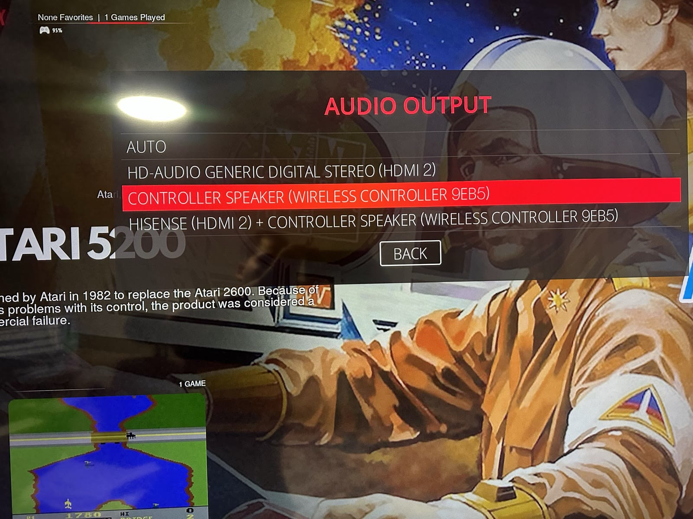
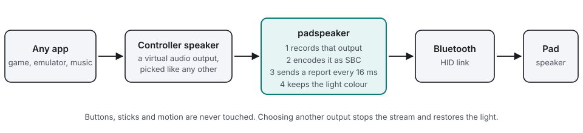

<div align="center">

<picture>
  <source media="(prefers-color-scheme: dark)" srcset="assets/logo-dark.svg">
  
</picture>

# padspeaker

**Play your computer's sound on the speaker built into a Bluetooth gamepad.**
It shows up as an audio output, picked like any other. Nothing to install on the pad.

<!-- ⚠️ All badges in a group must sit on ONE source line. GitHub renders a single newline as <br>, so
     one badge per line stacks them vertically instead of flowing them inline. -->

[](https://github.com/eknowledger/padspeaker/actions/workflows/tests.yml) [](https://github.com/eknowledger/padspeaker/actions/workflows/build.yml) [](LICENSE)

[](docs/LINUX.md) [](pyproject.toml) [](COMPATIBILITY.md) [](COMPATIBILITY.md)

</div>

```sh
padspeaker list     # the pads it found, and the outputs it made for them
padspeaker tone     # play a test tone on a pad's speaker
padspeaker run      # the daemon: one "Controller speaker" output per connected pad
```

Over USB a DualShock 4 is a sound card. Over Bluetooth it is not, so Linux offers no audio output for the speaker,
even though the pad accepts sound on its Bluetooth link. padspeaker sends it there. Built for and verified on
[Batocera](https://batocera.org); plain Python that should work on any Linux with PipeWire or PulseAudio, with no
runtime dependencies beyond the standard library, `libsbc` and the `pactl` and `parec` tools.

> **Not affiliated with Sony.** This is an independent, unofficial project. It is not affiliated with, endorsed by or
> sponsored by Sony Interactive Entertainment. "DualShock", "DualSense" and "PlayStation" are trademarks of their owners and
> are used here only to say which hardware this works with. The knowledge about how the pad's speaker works comes from
> public research by others (see [Credits](#credits)); no Sony code or firmware is used or included.

## What it looks like

The output appears in the system's own audio menu. This is Batocera's: the pad's speaker, and the TV plus the pad
together, sit next to the HDMI output.



Then the sound plays from the pad. Thirteen seconds, with sound: a game preview plays on the TV, then the camera moves
to the pad that is playing it.

[](https://youtu.be/9urLV7JDRmo)

## Contents

- [What it looks like](#what-it-looks-like)
- [Why](#why)
- [How it works, in plain words](#how-it-works-in-plain-words)
- [Status](#status)
- [Requirements](#requirements)
- [Quick start: Batocera](#quick-start-batocera)
- [Quick start: any Linux](#quick-start-any-linux-manual-run-no-service)
- [Choosing the output](#choosing-the-output)
- [Volume](#volume)
- [At boot, at shutdown, after a crash](#at-boot-at-shutdown-after-a-crash)
- [Configuration](#configuration)
- [Commands](#commands)
- [Troubleshooting](#troubleshooting)
- [Limitations](#limitations)
- [Tests](#tests)
- [Documentation](#documentation)
- [Credits](#credits)

## Why

Plug a DS4 into USB and it appears as a sound card, so its speaker works. Over Bluetooth it is only a HID device, not an
A2DP headset, so no audio output is offered for it. But Sony pads do accept speaker audio inside HID output reports on the
same Bluetooth link; Linux just has no driver for that. This project sends it.

## How it works, in plain words

<picture>
  <source media="(prefers-color-scheme: dark)" srcset="assets/how-it-works-dark.svg">
  
</picture>

1. A small background program (the daemon) watches for connected pads.
2. For each pad it creates a **virtual audio output** named `Controller speaker (Wireless Controller xxxx)`. It shows up in
   the normal audio output menu next to your HDMI or headphone outputs, and disappears again when the pad disconnects.
3. When you choose that output, the daemon records what is played to it, compresses the sound with the SBC codec in
   the exact format the pad expects, and sends it to the pad 16 milliseconds at a time. Twice a second it also re-sends
   the pad's light colour, because on the pads tested the light goes off as soon as audio is sent.
4. When you choose another output (or the pad goes away) it stops, hands the sound back and restores the pad's light.

It never changes your default output on its own (except to move it back when the selected pad vanishes, and to select again a combined output it had to rebuild), never touches
the pad's button and motion input, and sends the pad only two kinds of HID messages (audio and "set volume / light"). Besides
that it keeps the pad's Bluetooth link out of sniff mode and restores the light through the kernel; [SECURITY.md](SECURITY.md)
lists everything it writes and how to switch each part off. The byte-level details are in [docs/PROTOCOL.md](docs/PROTOCOL.md).

## Status

Version 0.1.0, alpha. It has been verified on **two DS4-compatible clones (Sony ids `054C:09CC`) over Bluetooth on Batocera
v41**, with PipeWire, BlueZ and kernel 6.11: sound from the daemon's output was clearly audible on the pads' speakers and the
pads stayed connected. What is verified, what is only covered by tests, and what is not supported (genuine Sony pads, the
USB dongle and other distributions are not yet verified; the DualSense is unsupported) is in
[COMPATIBILITY.md](COMPATIBILITY.md), which also tells you how to report your pad.

## Requirements

- Linux with Python 3.9 or newer (CI runs 3.9, 3.11 and 3.13; Batocera v41 has 3.11).
- `libsbc` (the file `libsbc.so.1`): Debian and Ubuntu `apt install libsbc1`, Fedora `dnf install sbc`, Arch
  `pacman -S sbc`. Batocera has it.
- `pactl` and `parec` (PulseAudio utilities) and a PulseAudio-compatible server: PipeWire with `pipewire-pulse`, or
  PulseAudio. Debian and Ubuntu `apt install pulseaudio-utils`.
- A DualShock 4 (v1 or v2) or clone, paired and connected over **Bluetooth** so that the kernel (`hid-playstation` on
  Batocera) exposes it as `/dev/hidrawN`.
- Write access to that `/dev/hidrawN` (root is fine; Batocera runs everything as root; on a normal Linux see [docs/LINUX.md](docs/LINUX.md) for a udev rule).
- Recommended: the BlueZ tools `hcitool` and `bluetoothctl` (Batocera has them; Debian and Ubuntu `apt install bluez`).
  Without `hcitool` the pad's Bluetooth link can stay in sniff mode, and streaming then drops after about 14 seconds
  (see "The sound stops after about 14 seconds" below and [docs/LINUX.md](docs/LINUX.md#without-hcitool)). `check` reports
  them as warnings, not failures.

`padspeaker check` tells you what is missing.

## Quick start: Batocera

On your computer, in a checkout of this repository (see [docs/BATOCERA.md](docs/BATOCERA.md) for the details):

```sh
deploy/install.sh --dry-run            # look at what it would do; nothing is changed
deploy/install.sh                      # install (the service is installed but NOT enabled)
ssh root@batocera.local 'cd /userdata/system/padspeaker && python3 tools/box_selftest.py --tone'
ssh root@batocera.local 'batocera-services enable padspeaker && batocera-services start padspeaker'
```

Then, with the pad connected: **Start > System Settings > Audio Output** and pick `Controller speaker (...)`.

`deploy/install.sh --enable` installs and enables in one step; `deploy/install.sh --uninstall` takes it all off again.
The installer needs SSH access to the Batocera (`--host user@address` if `batocera.local` does not resolve).

## Quick start: any Linux (manual run, no service)

From a checkout, nothing to install:

```sh
python3 -m padspeaker check        # is everything there?
python3 -m padspeaker list         # which pads and sinks do I have?
python3 -m padspeaker tone         # play a test tone on the pad (saves and restores its light)
python3 -m padspeaker run          # run the daemon in the foreground; Ctrl-C stops it
```

Or install the command: `pip install .` gives you `padspeaker` with the same sub-commands. While `run` is active,
select the `Controller speaker (...)` output in your desktop's sound settings, or from a shell:

```sh
pactl set-default-sink padspeaker_xxxx      # xxxx = last four hex digits of the pad's Bluetooth address
```

If `/dev/hidrawN` is not writable by your user, run the daemon as root or use the udev rule in
`deploy/udev/70-padspeaker.rules`. For a systemd user or system service see `deploy/systemd/`. Both are **untested
examples**; the whole generic-Linux setup (requirements, `pip install .` or a built wheel, how the runtime directory is
found, picking the output in GNOME, KDE and with `wpctl`/`pactl`, what to do without `hcitool`) is in
[docs/LINUX.md](docs/LINUX.md).

## Choosing the output

- **Batocera:** Start > System Settings > Audio Output, choose `Controller speaker (...)`. To go back to the TV or
  headphones, choose that one again.
- **Desktop Linux:** pick it in the sound settings, or use `pactl set-default-sink`.
- Sound only goes to a pad while its output (or a combined output that includes it, see below) is in use.

### Combined outputs: your main output and the controller speakers together

Besides one output per pad, the daemon creates **combined outputs** (PulseAudio/PipeWire `module-combine-sink`) so the same
sound can play on several speakers at once. They appear in the same audio output menu and are created and removed as
pads come and go:

| output (sink name) | menu text | plays to |
|---|---|---|
| `padspeaker_all` | Controller speakers (all) | every connected pad (only with 2 or more pads) |
| `padspeaker_tv_<xxxx>` | *label* + controller speaker (Wireless Controller xxxx) | the main output and that one pad |
| `padspeaker_tv_all` | *label* + all controller speakers | the main output and every pad (only with 2 or more pads; with one pad it would equal the line above) |

- **The main output** is whatever you were listening to: `tv_sink` if set; otherwise the output that is selected when the
  daemon first sees a pad, as long as it is not one of ours (usually HDMI to a TV, but it can be a monitor, headphones or
  a sound bar). If that output disappears, the daemon picks the then selected one again. With no main output, the
  combinations that include it are skipped. The configuration keys keep the word "tv" (`tv_sink`, `tv_label`,
  `combine_tv_pad`, `combine_tv_all`, `tv_delay_ms`) so existing files keep working, and so do the sink names
  `padspeaker_tv_*`, which saved selections refer to.
- **The *label*** in the menu text names the main output the way the output itself does. In order of priority:
  1. `tv_label` from the configuration, if set (`"TV"` gives `TV + controller speaker (Wireless Controller eeff)` and
     `TV + all controller speakers`).
  2. The output's own name: a TV or monitor reports its name (read from its EDID) as the sink property `node.nick` or
     `alsa.name` (see `pactl list sinks`). It is shown with the port from the sink's description, for example
     `Example Display (HDMI 2) + controller speaker (Wireless Controller 1122)` and `Example Display (HDMI 2) + all controller speakers`.
     Generic values are ignored: `HDMI`, `default`, `Analog`, `Digital`, `Speaker`, `Headphones`, `SPDIF` and the sound
     card's own name (such as `HD-Audio Generic`); `node.nick` is tried first, then `alsa.name`. A USB sound card whose
     nick is `USB Audio` is labelled `USB Audio` (it has no port in its description).
  3. The sink's description from the audio server, for example `HD-Audio Generic Digital Stereo (HDMI 2)`.
  4. The sink name, and "TV" if nothing at all is known.

  The label is cleaned up (quotes and control characters removed, at most 60 characters) because it goes to `pactl` as a
  property. The properties are read with one `pactl list sinks` when the main output (or its description) changes and then
  at most every 30 seconds, not on every poll. When the computed label changes (a different TV on the same port, a
  renamed port, a new `tv_label`) the affected combined outputs are rebuilt under the same names, and stay selected if
  they were. The sink names never depend on the label.
- A combined output has a **fixed list of speakers**, so the daemon removes and creates again the ones whose list
  changed whenever a pad connects or disconnects or the main output (or its label) changes.
- **A pad streams when its output is selected or is RUNNING** (sound is flowing into it through a combined output). It
  stops when it is neither for about 2 seconds (so it does not flap). The silence handling and the light keep-alive are
  unchanged.
- **Volume.** The pad's speaker volume follows the volume (and mute) of the selected output when that is a combined
  output that includes this pad (the volume keys change the selected output); otherwise it follows the pad's own
  output. The main output's leg follows the combined output's volume as well.
- **If a selected combined output goes away** (for example a pad is switched off), the daemon first moves the selected
  output back to the one you had before and, on Batocera, resets the saved `audio.device` (same as for single outputs).
- **No feedback loops by construction.** A combined output only ever plays to pad outputs and the main output; never to
  another combined output, and the main output may not be one of ours. The daemon only records a pad's *own* output.
- **The main output is ahead of the pad.** HDMI audio arrives about 100 to 150 ms earlier than the Bluetooth speaker, so
  lip sync is off in the combined outputs. `tv_delay_ms` is **planned** (delay the main output's leg) but not implemented
  yet; the key is accepted and does nothing.
- Each group can be switched off: `combine_pads`, `combine_tv_pad`, `combine_tv_all`. `padspeaker list` shows
  what exists (or would be created) and which pads are streaming; `status` shows it for the running daemon.

## Volume

The volume of the `Controller speaker` output (on Batocera the system volume keys, elsewhere the usual volume control or
`pactl set-sink-volume`) is mirrored to the pad's speaker volume within a fraction of a second. Muting the output mutes
the pad. The mapping is a gentle curve (the small speaker is quiet at low settings, so the lower half of the slider
is spread over audible levels) and 100 % is the pad's maximum. You can cap the loudest setting with
`speaker_volume_max`, see below. Volumes above 100 % are not amplified.

## At boot, at shutdown, after a crash

- **Boot (Batocera).** With the service enabled, Batocera starts it in the background at every boot. The daemon starts
  even if PipeWire is not ready yet and keeps trying to create the outputs (pauses grow to 30 seconds). A pad that is not
  connected yet has no output yet; its output appears when the pad connects (after you press its PS button), and the
  combined outputs follow. The daemon does not change your selected output or your saved `audio.device` at boot. We have
  not tested what Batocera does at boot when the saved `audio.device` is a pad's output and that pad is off: expect
  Batocera's own default until the pad connects and you select the output again.
- **Stopping or restarting the service** sends SIGTERM: the daemon stops streaming, restores the lights, moves the default
  output back if a pad's output was selected, and removes its outputs.
- **After a crash or `kill -9`** the next start removes outputs of ours that were left behind (it only touches names with
  its own prefixes) and the single-instance lock goes away with the process.
- **When a pad disappears** (switched off, out of range) its outputs go too. If it was the selected one, the default moves
  back to the previous output, and on Batocera the saved `audio.device` is reset (see "Troubleshooting").

## Configuration

Everything works without a config file. To change something, create a JSON file; every key is optional.
On Batocera the file is `/userdata/system/padspeaker/config.json` and the service picks it up when it exists (then
`batocera-services restart padspeaker`). Elsewhere pass `--config FILE` to `run`. Command line flags override the
file, and an unknown key is reported as an error rather than ignored.

```json
{
  "speaker_volume_max": 60,
  "jitter_reports": 4,
  "only_macs": ["aa:bb:cc:dd:ee:ff"]
}
```

| key | default | meaning |
|---|---|---|
| `log_file` | none (log to the console) | rotating log file (1 MB, three old copies). The Batocera service passes its own |
| `status_file` | in a private state directory | where the status snapshot for `status` is written; `null` turns it (and `status`) off |
| `lock_file` | in the same directory | single instance lock |
| `runtime_dir` | none | `XDG_RUNTIME_DIR` for `pactl` and `parec` when the daemon is started without one (the Batocera service sets `/var/run`) |
| `poll_interval` | 1 | seconds between scans for pads, 0.1 to 60 |
| `jitter_reports` | 3 | audio reports buffered before sending, 1 to 8. Each is 16 ms, so the default adds 48 ms of latency (a fixed 32 ms sender lead comes on top); raise it if the sound stutters |
| `speaker_volume_max` | 79 | cap for the pad's speaker volume, 0 to 79 (79 is the pad's maximum) |
| `sink_name_prefix` | `padspeaker_` | prefix of the virtual output names; the pad's address tail is appended |
| `keep_lightbar` | `true` | re-send the lightbar colour about every 0.5 s while streaming (also while the sound is silent). On the DS4 v2 clones tested, audio reports alone switch the light off; `false` turns the workaround off. Flag: `--no-keep-lightbar` |
| `lightbar_fallback` | `[0, 0, 64]` | `[red, green, blue]` (0 to 255, a dim blue) used when the pad's own colour cannot be read from the kernel LED class. Flag: `--lightbar-fallback R,G,B` |
| `disable_sniff` | `true` | take each pad's Bluetooth link out of sniff mode (`hcitool lp <MAC> RSWITCH`) when it connects, before streaming starts and every 30 s while streaming. Needed on tested hardware, see below. Flag: `--no-disable-sniff` |
| `disconnect_on_hid_loss` | `true` | when a write to the pad fails because its HID device vanished (ENODEV or EIO), run `bluetoothctl disconnect <MAC>` once (at most once a minute per pad) so the pad is cleanly disconnected and one press of the PS button reconnects it. Flag: `--no-disconnect-on-hid-loss` |
| `sync_batocera_audio_device` | `null` | when the daemon moves the default output away from a vanished pad, also reset Batocera's saved `audio.device` (through `batocera-settings-set`, never by editing the file) if it still names one of our outputs. `null` (and `true`, which behaves the same) means only where Batocera's tools exist; `false` never. Flag: `--no-sync-batocera-audio-device` |
| `combine_pads` | `true` | create `padspeaker_all` (needs 2 or more pads). Flag: `--no-combine-pads` |
| `combine_tv_pad` | `true` | create `padspeaker_tv_<xxxx>`, the main output plus one pad. Flag: `--no-combine-tv-pad` |
| `combine_tv_all` | `true` | create `padspeaker_tv_all`, the main output plus every pad (needs 2 or more pads). Flag: `--no-combine-tv-all` |
| `tv_sink` | `null` (automatic) | the sink the `padspeaker_tv_*` outputs play to together with the pads, usually the TV (names from `pactl list short sinks`); automatic means the selected output when the first pad appears, if it is not one of ours. Flag: `--tv-sink SINK` |
| `tv_label` | `null` (the output's own name) | wording for that output in the menu text of the combined outputs, e.g. `"TV"`. Unset means: its `node.nick` / `alsa.name` plus port (`Example Display (HDMI 2)`), else its description. Cleaned and cut to 60 characters; the sink names do not change. Flag: `--tv-label TEXT` |
| `tv_delay_ms` | `0` | **planned, not implemented**: delay for the main output's leg, 0 to 2000. Accepted, no effect yet. Flag: `--tv-delay-ms` |
| `start_on_running` | `true` | also start streaming when the pad's output is RUNNING (sound arrives through a combined output), not only when it is the selected output; it stops after about 2 s of neither. Flag: `--no-start-on-running` |
| `only_macs` | `[]` | only serve these pads (Bluetooth addresses, `aa:bb:cc:dd:ee:ff`); empty means all |
| `ignore_macs` | `[]` | never touch these pads: no output, no writes |
| `extra_pad_ids` | `[]` | extra `VVVV:PPPP` hex vendor and product ids (Bluetooth only) to treat as DS4-compatible, for clones that report other ids than Sony's. Only add ids of pads that really accept the DS4 speaker reports: audio is written to them. `padspeaker check` lists Bluetooth gamepads that were not recognised, with their ids. Flag: `--extra-pad-id VVVV:PPPP` (repeatable) |

## Commands

| command | what it does |
|---|---|
| `run` | the daemon; flags `--config`, `--log-file`, `--runtime-dir`, `-v` (debug), `-q` (quiet) and one per key above |
| `list` | connected pads, their outputs and the tools found; `--json` for scripts |
| `tone` | a test tone on a pad: `--pad MAC` or `--hidraw /dev/hidrawN`, `--seconds`, `--volume`, `--freq`. Keeps the light on like the daemon does. Refuses a pad the daemon is streaming to |
| `status` | what the running daemon is doing; exit status 0 when running, 3 when not |
| `check` | a PASS / FAIL checklist of the machine; exit status 1 when something required is missing |

On Batocera, `tools/box_selftest.py` is a deeper on-box check (it also creates and removes a temporary test output and
records from it); `--tone` plays 3 seconds on the first pad.

## Troubleshooting

**No sound.**
1. Is the pad's output the selected one? `pactl info | grep 'Default Sink'` should name `padspeaker_xxxx`.
2. Is the daemon running and does it see the pad? `padspeaker status` and `padspeaker list`. On Batocera:
   `batocera-services status padspeaker` and `tail /userdata/system/logs/padspeaker.log`.
3. Does the pad itself work? `padspeaker tone` (stop the daemon's streaming first by selecting another output).
   If the tone is silent, the pad's volume may be 0 or it is not a pad that speaks this protocol.
4. Is the output muted or turned down? Its volume is mirrored to the pad.
5. Run `padspeaker check`, or on Batocera `python3 tools/box_selftest.py`: both print what is wrong.

**Two pads: which one drives the menu?** Either pad can navigate EmulationStation's menus (and Batocera's Audio Output
menu); which speaker plays is chosen only by the output you select, not by the pad you pressed the buttons on. Each pad has
its own output, and `Controller speakers (all)` plays on both. Two pads stream at the same time only through a combined
output; a single pad's output feeds that pad alone. If a pad that is not in use keeps streaming after you went back to
the TV, see `start_on_running`.

**The sound stops after about 14 seconds, the pad drops out (a second pad, or any pad).** Symptom: `bluetoothd` logs
`hidp_send_message() BT socket write error: Resource temporarily unavailable (11)` about 14 s into streaming, then the
pad's HID device vanishes while the Bluetooth link stays up (the pad still shows as connected but does nothing). Cause:
the pad's link was in **sniff mode** (link policy `RSWITCH SNIFF`), a power saving mode that makes BlueZ miss its send
window under constant audio traffic. Fix, done by the daemon automatically (`disable_sniff`): `hcitool lp <MAC> RSWITCH`
when the pad connects, before streaming and every 30 s (BlueZ can set the policy again). Streaming then ran without write errors for
the whole test (55 s by hand, about 26 s through the daemon), where it had failed after about 14 s every time before. To verify by hand:

```sh
hcitool lp aa:bb:cc:dd:ee:ff              # must read: Link policy settings: RSWITCH   (no SNIFF)
hcitool lp aa:bb:cc:dd:ee:ff RSWITCH      # set it by hand if it does not
```

For links made later by the adapter you can also run `hciconfig hci0 lp rswitch` once. If the HID device vanishes anyway,
the daemon runs `bluetoothctl disconnect` (`disconnect_on_hid_loss`) so that one press of the PS button reconnects the
pad cleanly instead of leaving it half connected. The daemon log says `turned off sniff mode` whenever it had to act.

**The audio menu shows a raw name such as `padspeaker_1122` after the pad was switched off.** Batocera stores the chosen
output as `audio.device` in `batocera.conf`. When the pad vanishes while it is the output, the daemon moves the default
back to the previous output and, on Batocera, also resets that saved value with `batocera-settings-set audio.device`
(`sync_batocera_audio_device`) so the menu shows a real output. It only does so when the saved value is one of its own
outputs, and it never edits the file itself.

**The pad's light is off while playing.** Audio reports alone switch the light off on the pads tested, so while
streaming the daemon re-sends the colour about every 0.5 s (`keep_lightbar`, on by default). It takes the colour from the
kernel LED class (`/sys/class/leds/.../red|green|blue`, provided by `hid-playstation`), re-reads it once a second so a
recolouring by the system is followed, and uses `lightbar_fallback` (dim blue) if it cannot be read. If the light is
still off, check that `keep_lightbar` is not `false` and look for write errors in `padspeaker status`.

**The pad's light went off after playing.** When streaming ends, the light is restored from the kernel's LED values that
were read before streaming. That needs the kernel LED class for the pad. The self test reports it as
`lightbar LED class`. If it is missing, disconnect and reconnect the pad to get the light back.

**The output is missing from the menu.**
- The daemon is not running (see above), or the pad is not connected, or not recognised: `padspeaker list` shows what
  it found. Only Bluetooth pads with a known DS4 id are served; the pad's address must also pass `only_macs` and
  `ignore_macs`.
- The audio server was not ready: see the next item.
- You changed `sink_name_prefix`: the output has the new name.
- If a stale output remains after a crash: `pactl list short modules | grep null-sink`, then `pactl unload-module <id>`.

**PipeWire not ready at boot.** The service starts early. If PipeWire is not up yet, the daemon cannot create the output
and keeps retrying with growing pauses (up to 30 seconds), logging what it is waiting for, so it normally appears by
itself within a minute. If it does not, `batocera-services restart padspeaker` once the desktop is up and look at the
log.

**Pairing modes: the pad must be connected over Bluetooth in classic (PlayStation) mode.** Pair it as a normal DualShock
4: hold PS and Share until the light bar flashes quickly, then pair it from the Bluetooth menu. Only pads that identify
themselves as a DualShock 4 (`054C:05C4`, `054C:09CC`, `054C:0BA0`) on the Bluetooth bus are recognised. A pad that is
paired in another mode, or through an adapter that presents it as a different controller (Switch, Xbox or generic
gamepad style), does not show up in `list` and cannot play audio; re-pair it in its PlayStation mode. A DS4 clone that is in
the right mode but reports other ids is not recognised either: `padspeaker check` lists Bluetooth gamepads that were
not recognised, with the `VVVV:PPPP` to try in `extra_pad_ids` (it only reads; nothing is sent to them). A pad plugged in by
USB is a normal sound card and is not touched by this project.

**Crackling or stutter.** Bluetooth and 2.4 GHz Wi-Fi can share a radio. Put the Wi-Fi on 5 GHz or use a cable, raise
`jitter_reports` to 4 or 5 (adds 16 ms each), keep the pad close to the machine, and avoid more connected pads than you need.

## Limitations

- **DS4 v1, v2 and clones only.** Bluetooth only, with a known id (`054C:05C4`, `054C:09CC`, or the Sony dongle
  `054C:0BA0`) or one you added in `extra_pad_ids`. The DualSense (PS5) uses a different protocol and is **not** supported.
  Clones that do not implement the speaker will simply be silent. Genuine Sony pads have not been verified yet, see
  [COMPATIBILITY.md](COMPATIBILITY.md).
- **Speaker only.** The headset jack and the microphone are not used. A tiny speaker: good for
  menus, effects and voices, not for music enjoyment. Pads connected by USB are not touched (they are already sound cards).
- **Latency of about 100 to 150 ms** from the output to the speaker (jitter buffer 48 ms, a fixed 32 ms sender lead, plus Bluetooth and the pad's
  buffer). Fine for menus and effects, noticeable in rhythm games and lip-synced video. In the combined outputs the main
  output is that much *ahead* of the pad (`tv_delay_ms` is planned, not implemented).
- **Wi-Fi coexistence.** Adapters that share the 2.4 GHz band between Bluetooth and Wi-Fi can make the sound stutter,
  especially during big downloads.
- **Without `hcitool` a pad may drop** after about 14 seconds of streaming, a second pad first; see
  [docs/LINUX.md](docs/LINUX.md#without-hcitool).
- Streaming uses Bluetooth bandwidth that the pad's own input also needs, so it stops sending audio after a few seconds
  of silence and resumes when sound returns.
- Linux only (it uses `hidraw` and sysfs).
- Alpha software: the Batocera installer and service are new, and everything beyond "verified" in
  [COMPATIBILITY.md](COMPATIBILITY.md) is tested with fakes only. [SECURITY.md](SECURITY.md) lists exactly what the program writes.

## Tests

No hardware is needed.

```sh
python3 -m venv .venv
.venv/bin/pip install -r requirements-dev.txt
.venv/bin/python -m pytest
```

The tests cover the protocol builders (against a hand-computed CRC vector and the proof of concept's bytes), pad
discovery over a fake sysfs, sink management with a fake `pactl`, capture, the pacer, the streamer and daemon with fake
pads and clocks, the command line, the installer (the real remote scripts run against a fake `ssh` and a sandboxed
`/userdata`), the service script and the self test. The libsbc test runs only where `libsbc.so.1` exists. The
historical proof-of-concept script `tools/ds4_tone_poc.py` is kept only as an independent reference that the tests compare
the protocol builders against; use `padspeaker tone` for a hardware check.

## Documentation

- [docs/BATOCERA.md](docs/BATOCERA.md): install, enable, pick the output, uninstall, where files live, what is not modified.
- [docs/LINUX.md](docs/LINUX.md): any other Linux: requirements, install, running as a service, picking the output, without `hcitool`.
- [docs/PROTOCOL.md](docs/PROTOCOL.md): the byte-level protocol and how it was verified.
- [COMPATIBILITY.md](COMPATIBILITY.md): what is verified, what is not, and how to report your pad.
- [SECURITY.md](SECURITY.md): what the program writes, what runs as root, how to turn features off.
- [CHANGELOG.md](CHANGELOG.md)
- [ROADMAP.md](ROADMAP.md): what might come next, and what is not planned.
- [docs/ARCHITECTURE.md](docs/ARCHITECTURE.md): how it is put together and why; read before changing the code.
- [CONTRIBUTING.md](CONTRIBUTING.md)

## Credits

The speaker protocol is not ours: it was worked out by others, and this project stands on their work.

- SensePost, [Dual-Pod-Shock: emotional abuse of a DualShock](https://sensepost.com/blog/2020/dual-pod-shock-emotional-abuse-of-a-dualshock),
  who showed that a DualShock 4 plays audio sent as SBC inside Bluetooth HID reports.
- The PS4 Developer wiki, [DS4-BT](https://www.psdevwiki.com/ps4/DS4-BT), for the Bluetooth report layouts and CRC.
- [snipem/DS4Dongle](https://github.com/snipem/DS4Dongle), a working implementation to compare against.
- The controllers wiki, [DualShock 4 data structures](https://controllers.fandom.com/wiki/Sony_DualShock_4/Data_Structures).
- The [libsbc](https://git.kernel.org/pub/scm/bluetooth/sbc.git) authors for the SBC codec used here.

## License

[MIT](LICENSE).
