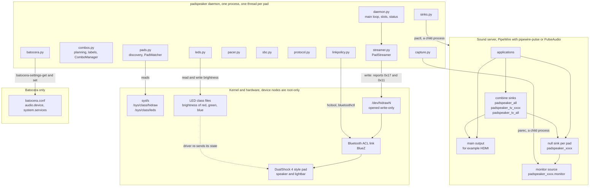
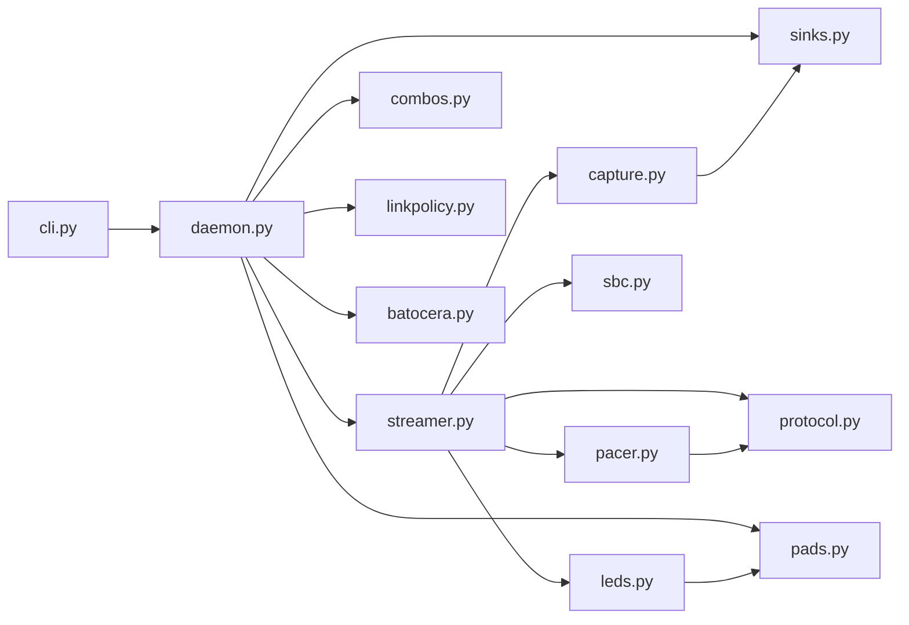
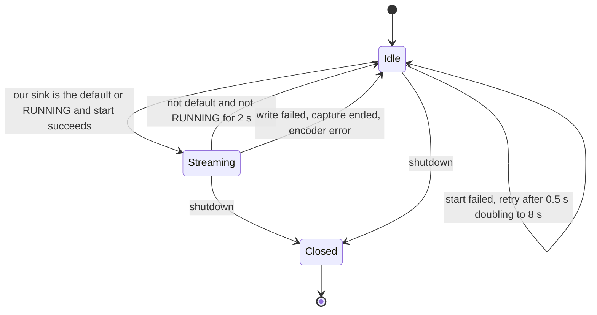
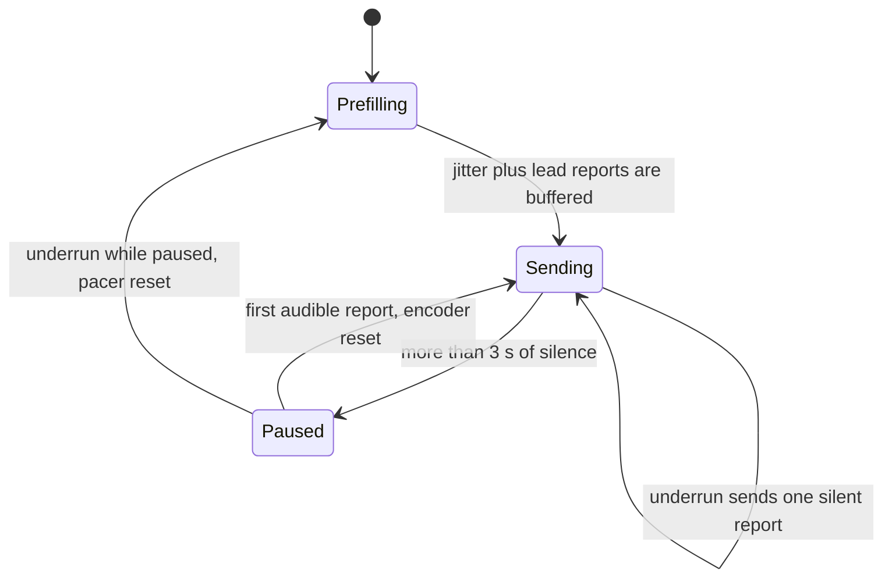
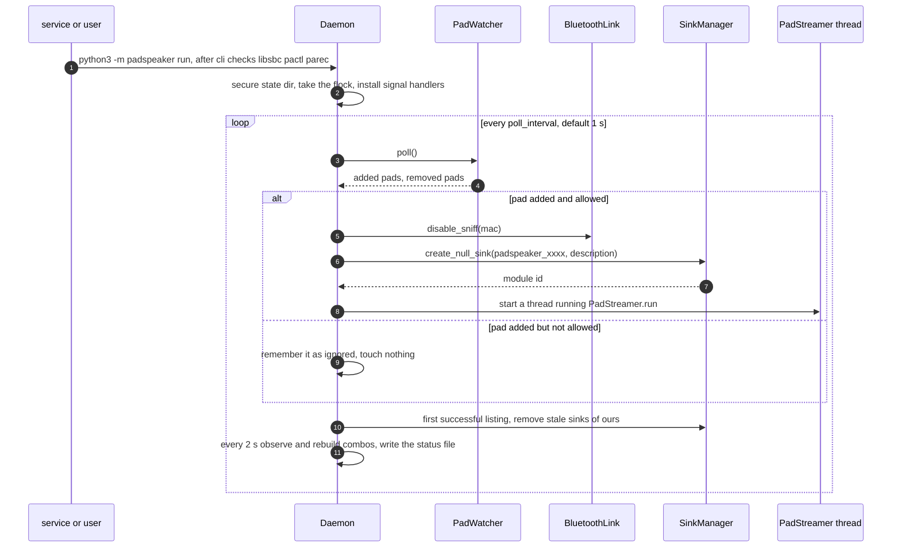
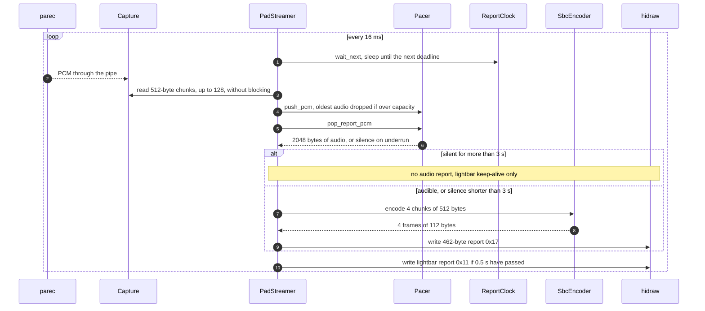
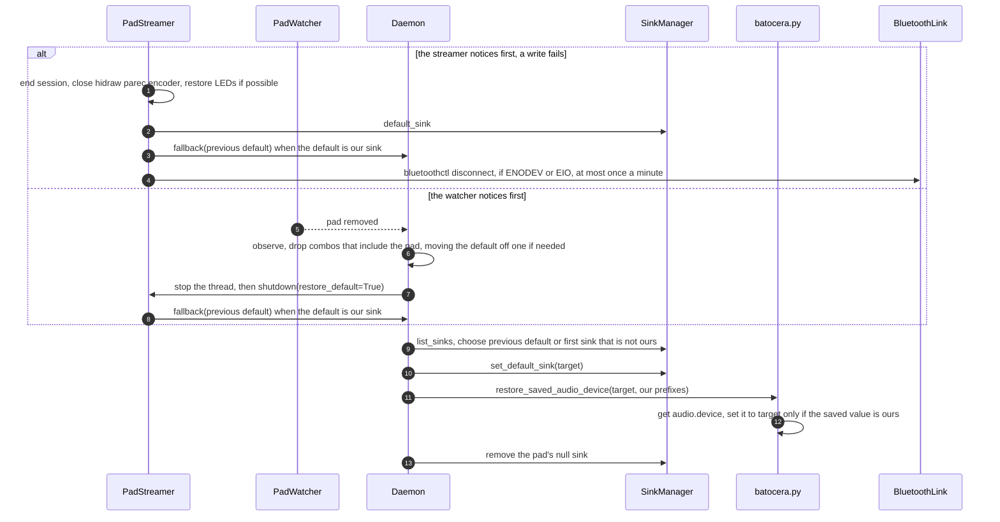
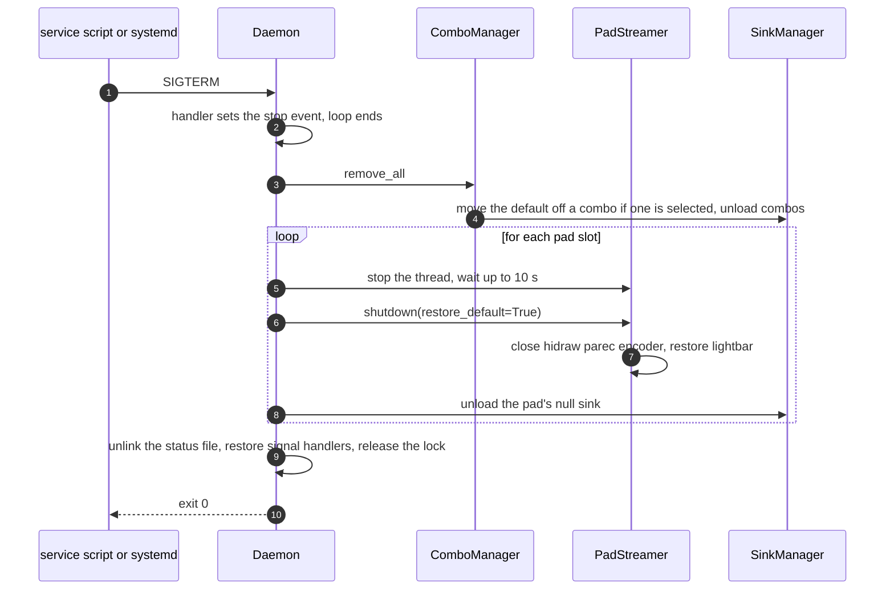
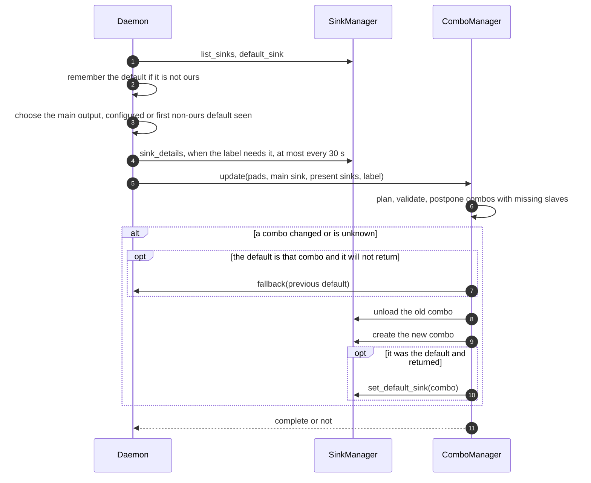

# Architecture

How padspeaker is put together, why the boundaries sit where they do, and what you need to know to change it.

**Audience.** Anyone working on the code, reviewing a change, packaging it for another system, or deciding whether to
trust it on their machine. It assumes you can read Python and a shell script. It does not assume you know how a
DualShock 4 talks over Bluetooth, what a PulseAudio sink is, or how Batocera starts services; §2 covers the vocabulary.
Byte-level detail of the wire format is in [PROTOCOL.md](PROTOCOL.md) and is not repeated here. Everything below was
checked against the code; where an intention and the code differ, the text says what the code does.

**Contents**

1. [Scope](#1-scope)
2. [Terminology](#2-terminology)
3. [System overview](#3-system-overview)
4. [Repository layout](#4-repository-layout)
5. [The wire protocol in brief](#5-the-wire-protocol-in-brief)
6. [Components](#6-components)
7. [Control flow](#7-control-flow)
8. [Invariants, and where they are enforced](#8-invariants-and-where-they-are-enforced)
9. [Lifecycle and teardown](#9-lifecycle-and-teardown)
10. [Timing and latency budget](#10-timing-and-latency-budget)
11. [How to change it](#11-how-to-change-it)
12. [Packaging, deployment and CI](#12-packaging-deployment-and-ci)
13. [Testing strategy](#13-testing-strategy)
14. [Defect register](#14-defect-register)
15. [Limitations and non-goals](#15-limitations-and-non-goals)
16. [Contributing](#16-contributing)
17. [Appendix](#17-appendix)

---

## 1. Scope

padspeaker does three things:

1. **Offers each connected pad as an audio output.** For every Bluetooth DualShock 4 style pad it creates a virtual
   sink named `Controller speaker (<pad name> <last four hex digits of its address>)`, plus optional combined outputs
   that play to several speakers at once.
2. **Streams the sound sent to such an output to the pad's speaker.** It records the sink, encodes the audio as SBC,
   and writes it to the pad as HID output reports every 16 ms, while keeping the pad's volume, lightbar and Bluetooth
   link in a state in which that works.
3. **Cleans up after itself.** When the pad leaves, the daemon stops, or it is killed, the outputs it made are
   removed, the default output is moved back if it pointed at a vanished pad, and the pad's light is restored.

Out of scope on purpose, and why:

| Not done | Why |
|---|---|
| Pad input (buttons, sticks, motion, touchpad) | The kernel driver owns it. Not touching it is what makes running next to a game safe. The pad node is opened write-only. |
| A GUI or tray icon | The outputs appear in the system's own audio menu, which is the interface. |
| Microphone | The reverse direction needs a capture path and echo handling. No use case yet (see [ROADMAP.md](../ROADMAP.md)). |
| Headset jack | The report has a target byte for it and `protocol.py` can build it, but nothing selects it, nothing is verified, and the pad's volume handling for it differs. |
| DualSense (PS5) | A different report format and codec path, so a second backend, not a flag. |
| USB pads | A USB DualShock 4 is already a sound card. Discovery ignores every bus but Bluetooth. |
| Non-Linux systems | It needs `hidraw` and sysfs. |
| Delaying the main output in combined outputs | Planned as `tv_delay_ms`. Accepted and ignored today (§15). |

## 2. Terminology

Skip this if the words are familiar.

| Term | What it means here |
|---|---|
| **HID** | Human Interface Device: the protocol game pads, keyboards and mice speak. Over Bluetooth, HID messages travel on the same radio link as everything else the pad does. |
| **hidraw** | A Linux interface that exposes a HID device as a plain file, `/dev/hidrawN`. One `write()` of a complete report sends one HID message. Usually root-only. |
| **Output report** | A HID message sent to the device (as opposed to an input report the device sends). padspeaker only ever sends two kinds, `0x17` (audio) and `0x11` (state). The first byte is the report id. |
| **CRC-32** | A checksum. The pad ignores reports whose last four bytes do not match. §5. |
| **SBC, libsbc** | The mandatory Bluetooth audio codec, and the C library that implements it. The pad's speaker takes SBC frames in fixed settings. `libsbc.so.1` is loaded at run time with `ctypes`. |
| **Frame, report, tick** | A *frame* is one SBC unit: 112 bytes carrying 4 ms of audio (bitpool 25, an SBC quality setting, makes it 112). A *report* is one HID message carrying 4 frames, so 16 ms. A *report tick* is the 16 ms moment one is due. |
| **Jitter buffer** | A small queue between a source that delivers audio irregularly and a sender that must send at an exact rhythm. `pacer.py`. |
| **Prefill, lead** | *Prefill*: audio collected before the first report is sent. *Lead*: how far ahead of real time the schedule runs, so the pad has a cushion. §10. |
| **Underrun, overrun** | Underrun: the queue is empty when a report is due. Overrun: audio arrives faster than it is sent and the queue is full. |
| **PulseAudio, PipeWire, `pipewire-pulse`** | Sound servers. Programs talk to PulseAudio's protocol, which PipeWire also speaks through `pipewire-pulse`. Everything here is written against that protocol. |
| **Sink** | An audio output as the sound server sees it: speakers, HDMI, or a virtual one. |
| **Monitor source** | Every sink has a recordable copy of what is played to it, named `<sink>.monitor`. This is how padspeaker gets the audio. |
| **Null sink** | A virtual sink that plays to nowhere. Its monitor is the only place the sound goes. One per pad (`module-null-sink`). |
| **Combine sink** | A virtual sink that forwards to several other sinks (its *slaves*). The slave list is fixed when it is created. `module-combine-sink`. |
| **Default sink** | The sink new sound goes to; what the system's audio menu changes. |
| **`pactl`, `parec`** | The PulseAudio command line tools. `pactl` controls the server (list, create, volume). `parec` records a source to standard output. |
| **State RUNNING** | `pactl list short sinks` calls a sink RUNNING while a stream is actively playing into it. Used to notice sound arriving through a combined output. |
| **Link policy, sniff mode** | A Bluetooth link may be allowed to enter *sniff mode*, a power saving mode in which it listens only at intervals. On the tested hardware this made BlueZ fail to deliver HID messages under constant audio traffic (§14). |
| **BlueZ, `hcitool`, `bluetoothctl`** | The Linux Bluetooth stack and its command line tools. `hcitool lp` reads or sets a link's policy. `bluetoothctl disconnect` disconnects a device cleanly. |
| **sysfs** | The kernel's file view of devices, under `/sys`. Pads are found here, never by opening devices. |
| **Kernel LED class** | How the kernel exposes LEDs as files. `hid-playstation` exposes the lightbar as `<prefix>:red`, `:green` and `:blue` directories with a `brightness` file. |
| **`hid-playstation`** | The kernel driver that binds Sony pads and creates the hidraw node and the LED files. |
| **Batocera** | A Linux distribution for retro gaming consoles. Everything runs as root and `/userdata` survives updates. The verified target. |
| **Batocera service** | A script in `/userdata/system/services/` that Batocera starts at boot if the service name is listed in `system.services`. `batocera-services` manages that list. |
| **`audio.device`** | The Batocera setting, in `batocera.conf`, that stores the chosen audio output. Read and written with `batocera-settings-get` and `batocera-settings-set`. |
| **Main output** | The sink the combined outputs play to together with the pads, usually a TV over HDMI. The config keys call it `tv_*` for compatibility. |
| **MAC tail** | The last four hex digits of a pad's Bluetooth address, in lower case. Used in sink names. |
| **flock** | An advisory file lock that disappears when the process dies. Used for the single instance guard. |
| **Seam** | A parameter or field through which a module receives its I/O (a runner, a clock, a factory) so a test can pass a fake. §13. |

## 3. System overview

Three worlds, and the thing to hold onto is that padspeaker lives in the middle: **it reads the kernel's view of the
pads, talks to the sound server through command line tools, and writes only two kinds of message to a pad.**



The diagram shows what the daemon reads and writes in each world (who imports whom is in §6). The data path in one sentence: **sound from any
application reaches the pad's null sink, `parec` records its monitor as 32 kHz stereo PCM, the streamer buffers it,
encodes each 4 ms as one 112-byte SBC frame, packs four frames and a CRC into a 462-byte report `0x17`, and writes one
report every 16 ms to the pad's hidraw node, which the kernel carries over the Bluetooth link.**

Reading the diagram:

* **Pads are found in sysfs, not by probing devices.** Discovery opens only small text files. The hidraw node is
  opened for writing only once a pad is known and its output is in use.
* **The sound server is reached through programs, not a library.** `pactl` and `parec` keep the package free of
  runtime dependencies and work against PipeWire and PulseAudio alike. The cost is a process spawn per query (§10).
* **Every helper program runs as an argument list with a timeout, never through a shell** (`parec` runs without a
  timeout because it is long-lived, but still without a shell).
* **Optional things are optional.** Without `hcitool`, `bluetoothctl` or the Batocera tools the daemon logs once and
  carries on. Without `libsbc`, `pactl` or `parec` it refuses to start (`cli.cmd_run`).

### 3.1 Who runs as what, and what is written where

| Context | Runs as | Writes |
|---|---|---|
| Batocera | root, because everything on Batocera is and the hidraw nodes are root-only. The service script starts the daemon at boot if enabled. | HID reports `0x17` and `0x11` to recognised pads; LED `brightness` files; null and combine sink modules in the audio server; link policy and disconnects through BlueZ tools; `audio.device` through `batocera-settings-set`; `/var/run/padspeaker/` (lock and status); `/userdata/system/logs/padspeaker.log*` |
| Other Linux | the user, in their own session. Write access to the hidraw node comes from a udev rule (an untested example). | The same, except no Batocera setting; the state directory is `$XDG_RUNTIME_DIR/padspeaker` |
| Installer | on the laptop as the user, on the box through `ssh` as the login given | Only `/userdata/system/padspeaker/`, the single file `/userdata/system/services/padspeaker`, and the logs folder. `system.services` only through `batocera-services`, and only with `--enable` |

Why root appears at all: the kernel makes hidraw nodes root-only, and Batocera has no other user. [SECURITY.md](../SECURITY.md)
lists every write and the config key that switches it off. The trust boundary that matters in the code is the
**recognised pad list** (§6.4): nothing is ever written to a device that did not come through `pads.discover_pads`.

## 4. Repository layout

```
padspeaker/
├── padspeaker/                     the Python package. Standard library only. The wheel ships only this
│   ├── __init__.py                 __version__, the single source of the version (pyproject reads it)
│   ├── __main__.py                 python3 -m padspeaker
│   ├── protocol.py                 report builders, CRC-32, frame counter, constants. Pure, no I/O
│   ├── sbc.py                      libsbc through ctypes: SbcEncoder, available()
│   ├── pacer.py                    Pacer (jitter buffer) and ReportClock (the 16 ms schedule). No clock of its own
│   ├── pads.py                     pad discovery in sysfs, PadWatcher, the recognised id list
│   ├── leds.py                     read, restore and preserve the lightbar through the kernel LED class
│   ├── sinks.py                    pactl wrapper: list, default, volume, null and combine sinks
│   ├── capture.py                  parec as a child process, select-based reads with a timeout
│   ├── streamer.py                 PadStreamer, the per-pad state machine; volume curve; HidrawDevice
│   ├── combos.py                   combined outputs: names, ownership, plans, labels, ComboManager
│   ├── linkpolicy.py               hcitool and bluetoothctl: sniff mode off, clean disconnect
│   ├── batocera.py                 keep the saved audio.device in step, through Batocera's tools
│   ├── daemon.py                   DaemonConfig, Daemon, InstanceLock, status file, logging, state directory
│   └── cli.py                      run, list, tone, status, check; the Environment seam; exit codes
├── tools/
│   ├── box_selftest.py             on-machine check; --tone plays 3 seconds. Ships to the box
│   └── ds4_tone_poc.py             the original proof of concept, kept as an independent copy of the protocol
├── deploy/
│   ├── install.sh                  the Batocera installer, run on the laptop
│   ├── padspeaker                  the Batocera service script (POSIX sh)
│   ├── systemd/padspeaker.service  system unit example, untested
│   ├── systemd/user/padspeaker.service   user unit example, untested
│   └── udev/70-padspeaker.rules    hidraw access example, untested
├── tests/                          pytest, one file per module, plus test_deploy.py and test_box_tools.py
├── docs/
│   ├── ARCHITECTURE.md             this file
│   ├── PROTOCOL.md                 the wire format, byte by byte, and how it was verified
│   ├── BATOCERA.md                 install, enable, where files live, what is not modified, migration
│   └── LINUX.md                    any other Linux: requirements, udev, systemd, runtime directory, no hcitool
├── .github/                        workflows (tests.yml, build.yml), dependabot, issue and PR templates
├── assets/                         logo, how-it-works diagram, screenshot and demo video for the README
├── README.md  SECURITY.md  COMPATIBILITY.md  CHANGELOG.md  ROADMAP.md  CONTRIBUTING.md  LICENSE
└── pyproject.toml  MANIFEST.in  pytest.ini  requirements-dev.txt
```

Module dependencies are one-way. `protocol`, `sbc`, `pads`, `sinks`, `linkpolicy`, `batocera` and `combos` import
nothing else from the package (`capture` imports `pulse_env` from `sinks`, `pacer` constants from `protocol`, `leds`
the `Pad` type from `pads`). `streamer` imports the leaves. `daemon` imports `streamer` and the leaves. `cli` imports
`daemon`. Nothing imports `cli` or `daemon` except `__main__` and tests, which is what keeps the pure modules testable
on their own.

## 5. The wire protocol in brief

Two reports are ever written to a pad. Layouts are in the appendix (§17.1) and byte by byte in [PROTOCOL.md](PROTOCOL.md).

| | Audio report | State report |
|---|---|---|
| Id and length | `0x17`, 462 bytes (`AUDIO_REPORT_ID`, `AUDIO_REPORT_LEN`) | `0x11`, 78 bytes (`STATE_REPORT_ID`, `STATE_REPORT_LEN`) |
| Carries | counter, target byte (`0x02` speaker), four SBC frames | update flags, lightbar RGB, speaker volume |
| Sent | every 16 ms while audio is flowing | volume: when it changes. Lightbar: about every 0.5 s while streaming |
| Built by | `build_audio_report` | `build_state_report`, `build_volume_report`, `build_lightbar_report` |

* **Write.** One `os.write()` of the whole report, id first, CRC last. No handshake and no pairing step.
* **CRC.** `zlib.crc32` over the byte `0xA2` followed by the report without its last four bytes, stored little endian
  (`crc32_report`). `0xA2` is the HID transaction header. It is part of the checksum and is not written.
* **Pacing.** The pad plays at a fixed rate, so the sender keeps to real time. Faster fills the pad's buffer, slower
  leaves gaps. The schedule uses absolute deadlines (`ReportClock`) so sleep jitter does not accumulate.
* **Why four frames per report.** The report length is fixed by the format: 462 = 6 header bytes + 4 x 112 + 4 zero
  bytes + 4 CRC bytes (`test_timing_is_consistent` asserts the sum), and `build_audio_report` rejects any other frame
  count. One frame is 128 samples at 32 kHz, so 4 ms, and four give the 16 ms tick.
* **Why dual channel SBC through libsbc.** The pad wants SBC in dual channel mode, 16 blocks, 8 subbands, loudness
  allocation, bitpool 25. ffmpeg's `sbc` encoder cannot select dual channel.
* **The counter** advances by 4 per report (one per frame) and wraps at 16 bits (`FrameCounter`).
* **The lightbar goes dark when audio reports are sent** on the tested pads, because audio reports carry no colour.
  That is why the state report is re-sent while streaming (§14).

## 6. Components



The graph shows who imports whom. Each subsection below gives a module's purpose, its public surface, **what is
injected for tests**, and what it **must never do**. The "never" lists are the invariants of §8, stated where they can
be broken.

### 6.1 `protocol.py`

**Purpose.** Lay out the two reports and their CRC. Pure: no I/O, standard library only.

**Surface.** The constants of §10 and §17.1 (`SAMPLE_RATE`, `SBC_FRAME_BYTES`, `FRAMES_PER_REPORT`, `REPORT_SECONDS`,
`TARGET_SPEAKER`, `TARGET_HEADSET`, `MAX_SPEAKER_VOLUME` 0x4F ...); `crc32_report`; `FrameCounter`; the builders
`build_audio_report(counter, frames, target)`, `build_state_report(volume, rgb)`, `build_volume_report`,
`build_lightbar_report`; `is_audio_report`, `is_state_report`, and `parse_audio_report` for tests and diagnostics.

**Injected for tests.** Nothing; it is pure. `tools/ds4_tone_poc.py` is a second, independent implementation that
`tests/test_protocol.py` compares against byte for byte (`test_audio_report_matches_poc_bytes_exactly`,
`test_volume_report_matches_poc_bytes`).

**Never.** Perform I/O. Produce a report id other than `0x17` or `0x11`. Accept a wrong frame count or frame size
(`ValueError`). Let a volume above `0x4F` through (it is clamped, not rejected). Build a lightbar-only report with a
channel outside 0 to 255 (`ValueError`).

### 6.2 `sbc.py`

**Purpose.** SBC encoding through libsbc with the pad's fixed settings.

**Surface.** `SbcEncoder` (`encode(pcm512) -> frame112`, `reset`, `close`, context manager), `available()`,
`SbcUnavailable` (its message says how to install the library), `SbcError`, `SbcStruct` (a ctypes mirror of `sbc_t`),
and the constants `BITPOOL` 25, `PCM_BYTES` 512, `FRAME_BYTES` 112, `FRAME_HEADER` `9c 75 19`.

**Why ctypes.** ffmpeg cannot be told "dual channel", and a compiled extension would break the no-dependencies rule and
the "copy the folder to the box" install. The library is found with `find_library("sbc")`, then the soname `libsbc.so.1`.

**Injected for tests.** `SbcEncoder(lib=...)` takes a fake library object. `tests/test_sbc.py` drives a `FakeLib` for
most tests; the three tests marked `needs_libsbc` use the real library and are skipped where it is absent.
`PadStreamer` takes `encoder_factory`.

**Never.** Import-fail when libsbc is missing (the library is loaded when an encoder is made, so `cli check` can
report it). Accept input that is not exactly 512 bytes. Return anything but one 112-byte frame starting `9c 75 19`
(`encode` checks bytes consumed, bytes written and the header). Keep libsbc state after `close()` (idempotent). Share
one encoder between streams: SBC keeps filter history, so a restart after a gap calls `reset()`.

### 6.3 `pacer.py`

**Purpose.** Turn irregular PCM delivery into a steady 16 ms rhythm.

**`Pacer`** is a byte-stream jitter buffer. `push_pcm` appends any amount of PCM. `pop_report_pcm` returns exactly
2048 bytes per call, or `None` until `target_reports` have been buffered (the prefill). After that it never returns
`None`: real audio when a whole report is buffered, otherwise a silent report counted as an underrun (a partial
report stays in the buffer and plays once complete). When the buffer would exceed `max_reports` the oldest bytes are
dropped in whole 4-byte stereo samples, so left and right never swap, and one overrun is counted. `stats` returns a
`PacerStats` snapshot.

**`ReportClock`** schedules `t0 + n x interval` with absolute deadlines. `wait_next()` sleeps until the next report is
due and returns how late it was. If it is later than `max_lag` (0.1 s) the schedule restarts from now and `resyncs` is
incremented, instead of sending a burst to catch up. `lead` makes the whole schedule run that much early (§10).

**Injected for tests.** `ReportClock(clock=, sleep=)`. `Pacer` reads no clock at all.

**Never.** Replay old audio (`test_underrun_never_replays_old_audio`). Drop half a sample. Send a burst after a stall.
Hold more than `max_reports` of audio.

### 6.4 `pads.py`

**Purpose.** Decide which devices are pads, and notice them coming and going.

**Surface.** `discover_pads(sysfs_root, dev_root, extra_ids) -> [Pad]`; `Pad` (`hidraw_path`, `mac`, `name`, `hid_id`,
`led_dir`, `extra_id`); `PadWatcher(discover=...)` whose `poll()` returns `(added, removed)`; `recognised_ids`,
`normalize_pad_id`, `mac_tail`; `list_unrecognised_gamepads` (the read-only hint behind `check`); constants
`BUS_BLUETOOTH` 0x0005, `VENDOR_SONY` 0x054C, `DS4_PRODUCT_IDS` (`05C4`, `09CC`, `0BA0`), `BUILTIN_PAD_IDS`.

**How a pad is recognised.** `/sys/class/hidraw/hidrawN/device/uevent` must have `HID_ID` on the Bluetooth bus, a
built-in Sony id or one in `extra_pad_ids`, and a valid `HID_UNIQ` address. The address becomes the pad's `mac`.
`led_dir` comes from matching the HID device's directory name against the real paths of the `/sys/class/leds` entries.
Result is sorted by address. A pad is identified by `(mac, hidraw_path)`, so a pad that returns on another node is
reported as removed and added.

**Injected for tests.** `sysfs_root` and `dev_root` (the tests build a fake sysfs under `tmp_path` with symlinks:
`add_hidraw`, `add_leds` in `tests/test_pads.py`), and `PadWatcher(discover=...)` for the daemon's tests.

**Never.** Open a device node. Accept a pad on any bus but Bluetooth, or without a valid address. Apply
`extra_pad_ids` to another bus. Raise on an unreadable or odd entry (it is skipped).

**This is the trust boundary.** Every path written to is a `Pad.hidraw_path` from here; `cli tone --hidraw` is matched
against this list before anything is opened (`cli._select_pad`).

### 6.5 `leds.py`

**Purpose.** Save and restore the lightbar colour through files the kernel already exposes.

**Surface.** `LedState(r, g, b)`, `read_led_state(pad)`, `restore_led_state(pad, state)`, and the context manager
`preserved_lightbar(pad)` (used by `tone`). Brightness files are `<led_dir>/<prefix>:red`, `:green`, `:blue`
(`/brightness`); the `:global` LED is deliberately ignored.

**Why the kernel files and not a state report.** Writing the values back makes `hid-playstation` send its own state
report, so the colour returns exactly as the driver would have set it.

**Injected for tests.** The directory in `pad.led_dir` (a `tmp_path` tree), in `tests/test_leds.py`; the streamer takes
`read_leds` and `restore_leds` callables.

**Never.** Raise on I/O (it returns `None` or `False`). Write outside the three colour files. Write a value outside
0 to 255 (clamped).

### 6.6 `sinks.py`

**Purpose.** Everything the daemon asks of the sound server, through `pactl`.

**Surface.** `SinkManager(runner, runtime_dir, timeout, pactl)` with `list_sinks`, `sink_details`, `sink_properties`,
`default_sink`, `sink_volume`, `sink_muted`, `sink_states`, `sink_state`, `set_default_sink`, `create_null_sink`,
`create_combine_sink`, `remove_null_sink` (by module id or by sink name, for null and combine modules alike); parsers
`parse_sinks_raw`, `parse_sink_details`; `quote_sink_properties`; `pulse_env`; `Sink`, `SinkDetails`, `SinkError`.

**Details that matter.**

* Every call is `pactl` with an argument list, `LC_ALL=C` (stable output), a timeout (`DEFAULT_TIMEOUT` 5 s) and, if
  `runtime_dir` is given, `XDG_RUNTIME_DIR` for the child. A hung audio server cannot hang the daemon.
* Creating a sink is **idempotent**: if the name exists, the module id behind it is returned (an error if it is not a
  module of the expected kind). That is how a restart after a crash adopts a leftover pad sink.
* The description goes into `sink_properties=...`, which the server parses twice, so `quote_sink_properties` escapes at
  both levels and rejects control characters. A sink's volume is its loudest channel in percent and may exceed 100.

**Injected for tests.** `runner(argv, env, timeout)` returning a `CompletedProcess`. `tests/test_sinks.py` uses a
`FakeRunner` keyed by sub-command; the daemon, streamer and CLI tests replace the whole object with fakes.

**Never.** Use a shell. Run without a timeout. Load a module other than `module-null-sink` or `module-combine-sink`.
Accept a sink name outside `^[A-Za-z0-9_.-]+$`. Change the default sink except through `set_default_sink`, which has
exactly two callers (§8).

### 6.7 `capture.py`

**Purpose.** Get the monitor's PCM into the process.

**Surface.** `Capture(sink, runtime_dir, parec, popen, terminate_timeout)`; `start()`, `read(n_bytes, timeout)`,
`close()`, context manager; `CaptureError`, `CaptureEnded`. It runs
`parec --device=<sink>.monitor --format=s16le --rate=32000 --channels=2 --latency-msec=16`, with standard input and
error discarded and an unbuffered pipe, and reads with `select` so a read can time out.

`read` returns exactly `n_bytes` or `b""`. Partial data stays buffered for the next call. If `parec` exits, buffered
data that completes a chunk is delivered first, then `CaptureEnded` is raised. `close` sends SIGTERM, then SIGKILL after
`terminate_timeout` (2 s), and always reaps.

**Injected for tests.** `popen` (a factory with `subprocess.Popen`'s signature) and `parec` (the program name). Two
tests in `tests/test_capture.py` run a real child process to prove the pipe and the reaping.

**Never.** Block past its timeout. Leave a zombie. Record anything but the pad's own sink (`PadStreamer` passes
`self.sink_name`), which is half of the no-feedback guarantee. (`SAMPLE_RATE` is defined here again, not imported; §11.6.)

### 6.8 `streamer.py`

**Purpose.** Everything that happens for one pad: decide whether sound is meant for it, stream when it is, and stop
cleanly when it is not.

**Surface.** `PadStreamer(pad, sink_name, sinks, config=, fallback=, runtime_dir=, clock=, sleep=, open_pad=,
capture_factory=, encoder_factory=, read_leds=, restore_leds=, link=, combo_lookup=)` with `step()`, `run(stop_event)`,
`shutdown(restore_default=)`, `snapshot()`; `StreamerConfig` (every tunable, §17.3); `StreamerStats`; `speaker_volume`;
`is_silent`; `HidrawDevice` and `open_hidraw`; the errno sets `PAD_GONE_ERRNOS` (EIO, ENODEV, ENOTCONN, EBADF) and
`HID_LOST_ERRNOS` (ENODEV, EIO).

**Threading.** `step()` does one small unit of work and returns how long the caller may wait; the daemon runs
`PadStreamer.run` in one thread per pad. A thread per pad, rather than stepping every pad from the daemon loop, because
streaming must hold a 16 ms rhythm with blocking sleeps and pipe reads, while the daemon loop makes slow `pactl` calls;
sharing a thread would let either stall the other. An `RLock` serialises `step` and `shutdown`.



The diagram shows the two real states, `IDLE` and `STREAMING`, plus the inert state after `shutdown()` (a `_closed`
flag; `step()` then returns 1.0 and does nothing). The transitions, from the code:

| Transition | Code | Detail |
|---|---|---|
| Idle, stay | `_step_idle` | Asks `pactl info` for the default sink at most every 0.5 s. Remembers the default as the user's *previous output* unless it is the pad's own sink or a known combined output (`_remember_other`). Acts only when `now >= _retry_at`. |
| Idle to Streaming | `_step_idle`, `_start` | When the default sink is the pad's sink (`via = default`), or, with `start_on_running`, when its state is `RUNNING` (`via = running`, which a combined output causes). `_start`, in order: remember the previous default; **read the lightbar**; turn sniff mode off; make the encoder; open the hidraw node; start `parec`; read the volume and send the first volume report. |
| Idle, start failed | `_abort_start`, `_schedule_retry` | Any exception: count a start failure, release what was opened (lightbar restored), retry after `_backoff`, doubling from 0.5 s to 8 s. If the pad is gone (errno in `PAD_GONE_ERRNOS` or `ENOENT`) the fallback also moves the default off the pad's sink. |
| Streaming to Idle, not wanted | `_step_streaming` | Every 0.5 s the default and state are read again. Neither default nor RUNNING starts a timer; after `stop_debounce` (2 s) the session ends cleanly and the backoff resets. A failed query neither starts nor stops anything. |
| Streaming to Idle, failure | `step`, `_on_write_error`, `_end_session` | `_write` turns an `OSError` or short write into `_WriteFailed`. The session ends with `error=True` and a retry with backoff (a session of at least `stable_seconds`, 5 s, resets the backoff first). Then `_after_pad_error`: errno in `PAD_GONE_ERRNOS` moves the default back; errno in `HID_LOST_ERRNOS` with `disconnect_on_hid_loss` runs `link.disconnect(mac)`. |
| Streaming to Idle, other errors | `step` | Any other exception, including `CaptureEnded` when `parec` dies and `SbcError`, is caught by the defensive `except Exception`, logged with a traceback, and ends the session with `error=True`. |
| to Closed | `shutdown` | Ends a running session, optionally moves the default off the pad's sink (`restore_default=True`: the pad vanished or the daemon exits), sets `_closed`. |

Inside `STREAMING` there is a second, smaller machine, per report:



* **Prefilling** (`pacer.stats.started` false): the streamer reads with a short blocking read (`prefill_poll`, 20 ms)
  until `jitter_reports + lead_reports` reports (5, so 80 ms) are buffered, then restarts the report clock. It keeps the
  lightbar alive meanwhile.
* **Sending**: each `step` waits for the next deadline, drains the capture (`_fill`, at most 128 reads of 512 bytes),
  takes one report of PCM from the pacer, encodes four frames, writes the audio report, and, if due, the lightbar.
* **Paused**: after `silence_seconds` (3.0) of PCM with every sample within `silence_threshold` (8 of 32767) of zero,
  audio reports stop. The clock keeps ticking, the capture keeps draining, the lightbar and sniff timers keep running.
  The first non-silent report unpauses and calls `encoder.reset()`. If the capture stalls while paused (underrun), the
  pacer is reset so the next sound is primed like a fresh start.

**Volume.** `speaker_volume(percent, muted, max_volume, gamma)` is `round(cap x (min(percent, 100) / 100) ** 0.6)`, at
least 1 for any non-zero volume, 0 when muted or at 0 %, never above `min(max_volume, 0x4F)`. A power curve below 1 spends
more of the slider on audible levels because the pad's speaker is quiet at low settings.

**Injected for tests.** Everything: `clock`, `sleep`, `open_pad`, `capture_factory`, `encoder_factory`, `read_leds`,
`restore_leds`, `link`, `combo_lookup`, `fallback`, and `sinks` (any object with `default_sink`, `sink_volume`,
`sink_muted`, optionally `sink_state`). `tests/test_streamer.py` builds a `World` with a `FakeClock` whose `sleep`
advances time, a `FakeCapture` that produces PCM in step with that clock, and a `FakePadDevice` that records
`(time, bytes)`; `World.run` fails a test if `step()` makes no progress, which turns a busy loop into a failure.

**Never.** Write anything but the builders' reports, or to a node other than `pad.hidraw_path`. Read from the pad. Touch
the default sink except by calling `fallback`. Raise out of `step()`. Spin (every path returns a delay or sleeps). Hold
more than `max(max_reports, prefill + 3)` reports of audio (8 by default). Skip the lightbar restore: it runs in a
`finally` after the handle, capture and encoder are closed, each guarded.

### 6.9 `combos.py`

**Purpose.** Name, plan, label and maintain the combined outputs. Mostly pure functions plus one small manager.

**Names and ownership.** Constants `PAD_PREFIX` `padspeaker_`, `ALL_PREFIX`/`COMBO_ALL` `padspeaker_all`, `TV_PREFIX`
`padspeaker_tv_`, `TV_ALL` `padspeaker_tv_all`, and `LEGACY_PREFIXES` (`ds4_speaker_`, `ds4_speakers_`, `ds4_tv_`) from
before the rename. `our_prefixes(pad_prefix)` returns the pad prefix, the two combo prefixes and the legacy ones;
`is_ours(name)` is `name.startswith(...)` on that tuple. **Ownership is decided by name prefix, not by a registry.** It
is what lets a restart recognise leftovers, and it is also why a user's own sink called `padspeaker_something` would be
treated as ours (§15).

**Plans.** `plan_combos(pads, tv_sink, flags, pad_prefix, tv_label)` returns `ComboSpec(name, description, slaves,
group)`:

| Name | Group | Slaves | Needs |
|---|---|---|---|
| `padspeaker_all` | `pads` | every pad sink | 2 or more pads, `combine_pads` |
| `padspeaker_tv_<tail>` | `tv_pad` | main sink, that pad's sink | a main sink, `combine_tv_pad` |
| `padspeaker_tv_all` | `tv_all` | main sink, every pad sink | a main sink, 2 or more pads, `combine_tv_all` |

Pads are sorted by address. A main sink that is one of ours is ignored. With one pad, `padspeaker_tv_all` would equal
the single pad's `padspeaker_tv_<tail>`, so it is skipped. `validate_plan` raises if a combo lists itself, lists
another combo, or lists anything that is neither a pad sink nor the main sink.

**Labels.** The menu text for a main-output combo is `<label> + controller speaker (<pad name> <tail>)` or
`<label> + all controller speakers`. `resolve_label` picks the label by priority: the configured `tv_label`; the
sink's own name (`node.nick`, then `alsa.name`, with the port from the description appended as `(HDMI 2)`), ignoring
generic values (`_GENERIC_NAMES`, `HDMI`-like names, the sound card's own name); the sink's description; the sink name;
`DEFAULT_LABEL` `TV`. `sanitize_label` removes quotes, backslashes and control characters and cuts to `MAX_LABEL` (60),
because the text ends up inside `sink_properties`. **The label goes into descriptions only; sink names never depend on
it**, so a saved selection survives a different TV on the same port.

**`ComboManager.update(pads, tv_sink, present, tv_label)`** is the rebuild rule (flow in §7.7):

1. Plan, validate (a refusal logs an error and plans nothing), then drop specs whose slaves are not all in `present`
   yet (the call then returns `False`, so the daemon retries in 2 s).
2. Forget combos that vanished by themselves.
3. A combo is removed if its desired `ComboSpec` differs from the active one (any change of slaves or description), or
   if it is wanted and present in the server but unknown to this process (a leftover from an earlier run).
4. If the default sink is a combo being removed: if it will be recreated, remember to select it again afterwards;
   otherwise call `fallback(previous_default)` first so sound never goes silent.
5. Unload, then create the missing ones, then re-select the default if needed.

**Injected for tests.** `sinks` (anything with `create_combine_sink`, `remove_null_sink`, `default_sink`,
`set_default_sink`), `fallback`, `previous_default`. All errors from the audio server are caught and logged.

**Never.** Create a combo that feeds a combo, feeds itself, includes an unknown sink, or includes a main sink that is
ours. Raise. Make a name depend on the label.

### 6.10 `linkpolicy.py`

**Purpose.** Keep the Bluetooth link in a state in which constant audio traffic does not break it, and clean up when it
breaks anyway.

**Surface.** `BluetoothLink(runner, clock, hcitool, bluetoothctl, timeout, disconnect_min_interval, which)` with
`disable_sniff(mac) -> SniffResult(ok, changed, detail)`, `disconnect(mac) -> bool`, `tools()`; the module function
`disable_sniff`.

* `disable_sniff` reads `hcitool lp <mac>`. If `SNIFF` is absent it is done and nothing is logged. Otherwise (or if
  the policy cannot be read) it runs `hcitool lp <mac> RSWITCH` and reads it back to verify. INFO is logged only when it
  really changed something. A failure is a WARNING once per distinct reason, then DEBUG, because the streamer retries
  every 30 s.
* `disconnect` runs `bluetoothctl disconnect <mac>`, at most once per `disconnect_min_interval` (60 s) per pad.
* A missing tool is remembered after the first `FileNotFoundError`, warned about once, and not retried.

**Injected for tests.** `runner(argv, timeout)`, `clock`, `which`.

**Never.** Raise. Use a shell. Pass an address that is not six hex pairs to a command (validated with `_MAC_RE` first).
Disconnect the same pad twice within a minute.

### 6.11 `batocera.py`

**Purpose.** After the daemon moves the default sink off a vanished pad, make Batocera's *saved* choice agree, so the
Audio Output menu does not show a raw name such as `padspeaker_1122`.

**Surface.** `restore_saved_audio_device(fallback, prefix, runner, which, timeout) -> bool`, `tool_available`.

**Behaviour.** Returns `False` without doing anything if the fallback is empty, starts with `-`, or is one of ours; if
either `batocera-settings-get` or `batocera-settings-set` is not on `PATH`; or if the saved `audio.device` does not
start with one of our prefixes. Only then does it run `batocera-settings-set audio.device <fallback>`. A saved value
that is the user's own choice is never replaced.

**Injected for tests.** `runner(argv, timeout)` and `which`; `Daemon` takes `batocera_restore`.

**Never.** Edit `batocera.conf` itself (it uses no file I/O at all). Raise. Set `audio.device` to one of our sinks. Run
where the tools are absent.

### 6.12 `daemon.py`

**Purpose.** The long-running process: own the pads, their sinks and streamers, and the operational plumbing around them.

**Surface.** `DaemonConfig` (`from_dict`, `allows`, `status_path`, `lock_path`), `load_config_file`, `Daemon`,
`InstanceLock`, `ThreadRunner`, `write_status_file`, `setup_logging`, `secure_state_dir` and the `default_*` path
helpers, `normalize_mac`, and the errors `ConfigError`, `AlreadyRunning`, `StateDirError`.

**Configuration.** A JSON object, every key optional; unknown keys, wrong types and out-of-range values are errors with a
plain message (`DaemonConfig.from_dict` checks against `_KEYS`). Command line flags override the file
(`cli.build_config`). Keys and their consumers are in §17.2.

**Per-pad ownership.** Each connected, allowed pad gets a `_Slot` keyed `(mac, hidraw_path)`: the pad, its sink name and
module id, its `PadStreamer` and runner thread, and a retry time and delay. The sink name is `sink_name_prefix +
mac_tail`, or the full address without colons if two pads share a tail.

**Main loop.** `run()` takes the lock, installs handlers, then repeats `tick()` and `stop.wait(poll_interval)` (default
1 s). A `tick()`:

1. `watcher.poll()`; `_remove_pad` for removed pads, `_add_pad` for added ones.
2. For every slot that is not ready and whose `retry_at` has passed, `_setup_slot` again.
3. If combined outputs are enabled and they are dirty or `OBSERVE_INTERVAL` (2 s) has passed, `_observe`.
4. Until it has succeeded once, `_remove_stale_sinks`.
5. Write the status file if anything changed or `STATUS_INTERVAL` (2 s) has passed.

**Backoff.** Creating a pad's sink fails while the audio server is not up. The slot retries after 1 s, doubling to 30 s,
logging a warning at most once per 60 s with how long it has waited. The daemon runs regardless; `status` shows
`sink_ready: false` and the error.

**Signals.** SIGTERM and SIGINT call `request_stop()` (sets an event). Handlers are installed only on the main thread and
restored afterwards. The loop ends, `shutdown()` runs in a `finally`, `run()` returns 0.

**Single instance.** `InstanceLock` takes a non-blocking exclusive `flock` on `daemon.lock` and writes the pid. The lock
vanishes with the process, so a crash leaves no stale lock. The file is opened with `O_NOFOLLOW` and must be a regular
file owned by the user; its directory (`secure_state_dir`) must be a real directory, owned by the user, not writable by
others, created with mode 0700. The directory is `<runtime_dir>/padspeaker`, else `$XDG_RUNTIME_DIR/padspeaker` if that
names a directory the user owns, else `/run/padspeaker` for root; otherwise the daemon refuses to start rather than use
`/tmp` (`StateDirError`).

**Status file and logs.** `status.json` in the same directory, written atomically (random temp name opened with
`O_EXCL | O_NOFOLLOW`, then `os.replace`), mode 0644 inside the private directory. Keys: `version`, `pid`, `state` (always
`running`), `started_at`, `updated_at`, `pads` (each with `mac`, `name`, `hidraw`, `sink`, `sink_ready`, `sink_error`,
`streamer` snapshot), `tv_sink`, `combos`, `ignored`. It is unlinked on shutdown; a failure to write it is logged once.
`setup_logging` adds a console handler and, with `log_file`, a rotating file handler (1 MiB, three backups); an
unwritable log file is a warning, not a failure.

**Injected for tests.** `sinks`, `watcher`, `streamer_factory`, `runner_factory`, `link`, `batocera_restore`, `clock`,
`wall_clock`; `run(install_signals=False)`. `tests/test_daemon.py` has a `Harness` with fakes for all of them and
calls `tick()` by hand, so the loop's logic is tested without time or threads. Two tests use real threads and signals.

**Never.** Touch a pad that `allows()` refuses (no sink, no write). Touch a sink that is not ours. Raise out of `tick()`
because the audio server or sysfs failed (every call is guarded and retried). Start a second instance. Use a shared
directory for its files.

### 6.13 `cli.py`

**Purpose.** The command line, and the `Environment` seam that makes it testable.

| Command | What it does | Exit codes |
|---|---|---|
| `run` | Checks `libsbc`, `pactl`, `parec`, builds the config from the file and flags, runs `Daemon.run()` | 0 stopped normally, 1 a required tool is missing, 2 bad config, 4 another instance is running |
| `list` | Pads, their sinks, recognised ids, tools, the combined outputs it would create, whether the daemon is streaming (`--json` available) | 0 |
| `tone` | A sine test tone on one pad with volume, keep-alive lightbar and LED restore; refuses a pad the daemon is streaming to | 0, 1 failure, 2 usage, 4 daemon busy with that pad |
| `status` | Reads the status file; running if it is younger than `STATUS_MAX_AGE` (10 s) and its pid is alive | 0 running, 3 not running |
| `check` | A PASS, FAIL, WARN, SKIP checklist (Python, tools, audio server, runtime dir, Bluetooth tools, state dir, unrecognised gamepads, hidraw access) | 0, or 1 if any row is FAIL |

Parsing errors exit 2 (`argparse` is subclassed to print the project's wording). Ctrl-C outside the daemon exits 130
(inside `run` the daemon's own handler turns SIGINT into a clean stop and exit 0). An unexpected exception exits 1 with
a one-line message and a debug-level traceback.

**Injected for tests.** `Environment` is a dataclass of callables: `discover`, `discover_extra`, `unrecognised`,
`make_sinks`, `which`, `sbc_available`, `encoder_factory`, `open_pad`, `access`, `clock`, `sleep`, `wall_clock`,
`make_daemon`, `pid_alive`, `python_version`, `isdir`, `getenv`, `default_status_file`, `link`. `main(argv, env, out,
err)` never raises. `tests/test_cli.py` has a `Box` that builds one with fakes and a `run(*argv)` helper.

**Never.** Write to a pad other than in `tone`, and then only to a pad from discovery. Run `tone` against a pad the
daemon is streaming to. Print a traceback to a user.

### 6.14 Deployment pieces

#### The installer, `deploy/install.sh`

Runs on the laptop (bash 3.2 compatible, `set -eu -o pipefail`) and sends short POSIX `sh` scripts over `ssh -o
BatchMode=yes -o ConnectTimeout=10`. There is no `scp`; the tarball is streamed with `cat >`. `--dry-run` prints every
script and sends nothing. Phases, in order:

| Phase | Script | What it does | Failure behaviour |
|---|---|---|---|
| Build | `build_package` (local) | Tarball of `padspeaker/` and `tools/` (regular files only, no caches or hidden files), the service script, `VERSION` (version, git revision, `-dirty` if modified), and `MANIFEST.sha256` of every file. Owner forced to root, plain ustar. A last check greps the listing for junk. | Dies before any network use |
| Preflight | `script_preflight` | Read only. Needs `tar gzip sha256sum awk df find cmp`, free space on `/userdata` of at least `--min-free-mb` (floor 50), Python 3.9+, `libsbc.so.1` loadable, `pactl` and `parec`, and `batocera-services` with `--enable`. Lists every problem with its fix, then stops. An unreachable audio server is only a warning. | `nothing was changed` |
| Upload, stage | inline, `script_stage` | `ssh host "mkdir -p DEST && cat > STAGE.tar.gz"`. Then: compare sha256, refuse unsafe paths, extract into `DEST/.staging-<ts>`, check required files, `sha256sum -c MANIFEST.sha256`, compile every `.py` with the box's Python, import the staged package and run `-m padspeaker --version` **from the staged copy**, `sh -n` the service script | Dies; the installed version is untouched; the staging folder is removed on exit |
| Swap | `script_swap` | For `padspeaker`, `tools`, `service`: move the old to `<name>.previous` (dropping the older `.previous`), move the new in. `MANIFEST.sha256` and `VERSION` through a temp file and `mv`. The service script is copied to a hidden temp name in `DEST` and `mv -f` into `/userdata/system/services/` (one atomic rename on the same filesystem). | `rollback()` puts the old folders back |
| Verify | `script_verify` | Manifest again, file count equals manifest lines, `--version`, service script executable and `cmp`-identical to the packaged one, `sh -n`; prints `VERIFY-OK` | Dies, leaving `.previous` |
| Migrate | `script_migrate` | If an install under the old name exists: stop its service (and give up, changing nothing, if it will not stop), disable it if it was enabled, remove its script, copy its `config.json` unless a new one exists, move its whole folder to `ds4-bt-speaker.old-<timestamp>`; prints `MIGRATE-ENABLE` if the old service was enabled | Never deletes anything |
| Activate | `script_activate` | With `--enable` (or `MIGRATE-ENABLE`): `batocera-services enable` and `restart`, and checks the state is `started`. Otherwise restarts the service only if it was already running. | |

The swap is a short sequence of renames with rollback, not one atomic operation across three folders; only the service
script is replaced atomically. `--uninstall` stops the service, runs `batocera-services disable`, and removes the app
folders (and their `.previous`) and the service script, keeping `config.json` and the logs unless `--purge --yes`. Every
remote path stays inside `DEST`, the services folder, the logs folder, `/var/run` and, read-only, `batocera.conf` (§8).

#### The Batocera service script, `deploy/padspeaker`

POSIX `sh`, because Batocera runs it directly at boot (dash) and through `bash script start` from `batocera-services`.
`start` is idempotent: it does nothing if the daemon runs, rotates the log if above 1,000,000 bytes, then starts
`python3 -m padspeaker run --log-file LOG [--config CONFIG]` in the background with `XDG_RUNTIME_DIR=/var/run` (where
Batocera's PipeWire keeps its socket), `PYTHONPATH` set to the install folder, `HUP` ignored, input from `/dev/null` and
output to `LOG.console` (truncated each start). It writes the pid file and checks 2 s later (`START_TICKS` 8 x 0.25 s)
that the daemon is alive, otherwise prints the tails of both files and fails. `stop` sends SIGTERM, waits up to 10 s
(`STOP_TICKS` 40), then SIGKILL. **It only signals a process whose command line contains `padspeaker`** (`is_ours`, from
`/proc/<pid>/cmdline`), so a stale pid file can never kill something else. `status` prints `started` (exit 0) or
`stopped` (exit 3). `PADSPEAKER_*` variables override paths and tick counts for the tests.

#### systemd and udev examples

`deploy/systemd/user/padspeaker.service` is the recommended unit on a desktop: it runs in the user's session, so the audio
socket is found without help. `deploy/systemd/padspeaker.service` is for a dedicated box: it needs `User=` and an
explicit numeric `XDG_RUNTIME_DIR=/run/user/<uid>` (systemd's `%U` is the manager's uid in a system unit, which is why
a test forbids it). Both use `Restart=on-failure` and `TimeoutStopSec=15` so SIGTERM can finish cleanup.
`deploy/udev/70-padspeaker.rules` gives a group write access to Bluetooth Sony hidraw nodes only
(`KERNELS=="0005:054C:*"`, `MODE="0660"`). **All three are untested on real systems**; tests only check their shape.

#### The on-box self test, `tools/box_selftest.py`

Ships to the box and uses only the package next to it. It checks Python, libsbc, an encoded frame, `pactl`/`parec`, the
Bluetooth tools (warnings), the audio server, a temporary test sink (`padselftest_<pid>`, always removed) with a
recording from its monitor, pad discovery, write access to the hidraw node (opened `O_WRONLY` and closed, nothing
written), and the LED class. `--tone` plays 3 seconds on the first pad. Exit 1 only if a *required* check failed. Its
`Deps` dataclass is the same kind of seam as `cli.Environment`.

## 7. Control flow

### 7.1 Start-up and pad discovery



The sequence shows start-up and discovery. If the sink cannot be created (the audio server is not ready), the slot keeps
the pad, the next `tick()` retries after 1 s, 2 s, ... up to 30 s, and the daemon is otherwise healthy. A pad that is not
connected yet simply is not in `poll()`; its slot appears when it connects. The daemon never changes the default output
or any saved setting at boot.

### 7.2 Selecting the output; streaming starts

Nothing is sent to a pad until the user has chosen its output. Then, in `PadStreamer` (§6.8):

1. The user picks `Controller speaker (...)`; the sound server's default sink becomes `padspeaker_xxxx`.
2. The idle streamer sees it on its next `pactl info` poll (every 0.5 s) and calls `_start`.
3. `_start` remembers the previous default, reads the lightbar from the kernel LED files, turns sniff mode off, opens the
   hidraw node write-only, starts `parec` on `padspeaker_xxxx.monitor`, reads the sink's volume and mute, and writes the
   first volume report `0x11`. Any failure releases what was opened and schedules a retry with backoff.
4. State is now `STREAMING`, in its prefilling phase: 5 reports (80 ms) are collected before the first audio report.

The same path is taken when the sink is only `RUNNING` (sound arriving through a combined output), with `via = running`.
The delay from choosing the output to the first sound is at most one 0.5 s poll plus the 80 ms prefill plus the process
starts. It has not been measured.

### 7.3 Steady state, every 16 ms



The sequence shows one tick. The policies it implements:

| Situation | What happens | Where |
|---|---|---|
| **Underrun** (nothing buffered when a report is due) | One silent 2048-byte report is sent and counted. Old audio is never repeated. A partial report waits for its remaining bytes. | `Pacer.pop_report_pcm` |
| **Overrun** (buffer over `max_reports`) | The oldest samples are dropped, in whole stereo samples, and one overrun is counted. Usually follows a stall of the streaming thread. | `Pacer.push_pcm` |
| **Sender late by more than 100 ms** | The schedule restarts from now, `clock_resyncs` is incremented, one report is sent. No burst. | `ReportClock.wait_next` |
| **Silence, then sound** | After more than 3 s of near-zero PCM, audio reports stop while the loop keeps its rhythm, which frees Bluetooth bandwidth for the pad's own input. The lightbar keep-alive continues. When sound returns, `encoder.reset()` drops filter history and the next report carries audio, within one tick. | `PadStreamer._step_streaming` |

A failed or short write ends the session (§6.8). The lightbar report goes out right after an audio report, in the slack
before the next deadline; deadlines are absolute, so its write time comes out of the next sleep and does not delay audio.

### 7.4 Volume and mute

While streaming, every 0.25 s the streamer reads the percent and mute state of its *volume source* with `pactl
get-sink-volume` and `get-sink-mute`, maps them with `speaker_volume` (curve, mute to 0, cap), and writes a volume report
only if the result changed (`_update_volume`). The volume source is the default sink when it is a combined output that
includes this pad, otherwise the pad's own sink, so the volume keys always move the pad in step with the control the
user is turning. A failed read changes nothing and is retried on the next period.

### 7.5 A pad vanishes while it is the default output



The sequence shows the two ways the loss is noticed and the one way it is repaired. What moves back is the **default
sink**, to the output the user had before choosing a controller speaker (remembered while idle, so it exists even if the
user never streamed), or to the first sink that is not ours. On Batocera the **saved `audio.device`** is reset too, but
only if it still names one of our sinks (`sync_batocera_audio_device`). The target is never one of ours; if no other sink
exists the daemon logs that and does nothing.

### 7.6 Graceful shutdown and crash recovery



The sequence shows an orderly stop (SIGTERM or Ctrl-C). Combos go first because they refer to the pad sinks, and a
combo that is selected must not be left as the default. The service script gives the daemon 10 s before SIGKILL.

**Crash recovery.** After `kill -9` or a power loss nothing runs the above. On the next start:

* The `flock` is gone with the process; the status file is stale and `status` ignores it after 10 s or a dead pid.
* Leftover null sinks are adopted if the pad is still there (`create_null_sink` is idempotent) and otherwise removed by
  `_remove_stale_sinks`: every sink with one of our prefixes (legacy ones included) that is not wanted, moving the default
  away first if it points at one. Leftover combos are removed and recreated (`ComboManager.update`).
* The pad simply stops receiving reports. Nothing restores its lightbar in this case.

### 7.7 Combined-output rebuilds



The sequence shows one observation. It runs every 2 s (`OBSERVE_INTERVAL`), at once when the combos are marked dirty (a
pad's sink appeared or went away, or the last pass was incomplete), and right before a removed pad's teardown. The
**main output** is `tv_sink` if it exists and is not ours; otherwise the first default seen that is not ours and not a
`.monitor`, kept until it disappears. Label properties come from one `pactl list sinks` when the main output or its
description changes and otherwise every 30 s (`LABEL_REFRESH`), and not at all when `tv_label` is set. A changed label
rebuilds only the main-output combos, under the same names, and a selected one stays selected.

## 8. Invariants, and where they are enforced

Rules the rest of the system relies on. Each is checked in one place and has a test unless the last column says
otherwise.

| Invariant | Enforced in | Test |
|---|---|---|
| Only reports `0x17` and `0x11` are written to a pad | The builders in `protocol.py` are the only producers; the three writers (`PadStreamer._write`, `cli.play_tone`, `box_selftest.play_tone`) call only them | `test_protocol.py`: `test_audio_report_length_and_fixed_header`, `test_volume_report_layout`, `test_lightbar_report_layout`; `test_streamer.py`: `test_streams_paced_valid_reports`, `test_lightbar_report_is_a_valid_state_report`; `test_cli.py`: `test_tone_plays_valid_paced_reports_and_restores_the_lightbar`. **No test asserts the closed set globally.** |
| Writes go only to recognised Bluetooth pads | `pads.discover_pads` (bus 0005, Sony ids or `extra_pad_ids`, valid address); `DaemonConfig.allows` (`only_macs`, `ignore_macs`); `cli._select_pad` | `test_pads.py`: `test_ignores_usb_sony_pad`, `test_ignores_bluetooth_non_sony_and_unknown_sony_product`, `test_extra_ids_only_apply_to_the_bluetooth_bus`; `test_daemon.py`: `test_ignored_and_unlisted_pads_are_left_alone`; `test_cli.py`: `test_tone_refuses_devices_that_are_not_known_pads` |
| The pad's input is never read | `HidrawDevice` opens `O_WRONLY`; discovery reads only sysfs text files | `test_box_tools.py`: `test_hidraw_check_opens_write_only_and_never_writes` (the self test's equivalent); `test_pads.py`: `test_the_hint_only_reads`. **`HidrawDevice` itself has no test pinning `O_WRONLY`.** |
| Speaker volume is capped at `0x4F` and at `speaker_volume_max` | `build_state_report` clamps; `speaker_volume` takes `min(max_volume, 0x4F)`; `DaemonConfig` validates 0 to 79; `tone --volume` validates 0 to 79 | `test_protocol.py`: `test_volume_report_clamps`; `test_streamer.py`: `test_volume_curve_endpoints_and_cap`, `test_volume_cap_from_config`; `test_cli.py`: `test_tone_default_volume_is_within_the_cap` |
| The light is restored from the values read before streaming | `PadStreamer._start` reads before opening anything; `_release_resources` restores in a `finally` after closing the handle, capture and encoder; `leds.preserved_lightbar` for `tone` | `test_streamer.py`: `test_start_sequence`, `test_shutdown_stops_streaming_and_restores_light`, `test_led_restore_runs_even_if_closing_fails`, `test_unreadable_lightbar_is_not_restored`; `test_leds.py`: `test_preserved_lightbar_restores_on_exception`; `test_cli.py`: `test_tone_restores_the_lightbar_when_it_fails` |
| The default output changes only to move it back to a real output (or to re-select a combo that was already selected and had to be rebuilt) | `set_default_sink` has two callers: `Daemon._fallback` and `ComboManager.update` (`keep_default`). The fallback never picks one of ours | `test_daemon.py`: `test_fallback_prefers_the_previous_default`, `test_fallback_without_a_usable_previous_picks_another_real_sink`, `test_default_combo_vanishing_restores_the_previous_default_and_batocera`; `test_streamer.py`: `test_shutdown_restore_default_is_skipped_when_sink_is_not_default`; `test_combos.py`: `test_no_fallback_when_the_default_is_something_else`, `test_rebuilding_the_default_combo_keeps_it_the_default`. **No test asserts the negative globally.** |
| Sinks are created and removed only under our prefixes, legacy ones included | `combos.is_ours` / `our_prefixes`; `Daemon._remove_stale_sinks` filters on it; `remove_null_sink` by name only unloads null and combine modules | `test_daemon.py`: `test_stale_sinks_of_ours_are_removed_once_pads_are_known` (asserts the HDMI sink survives), `test_stale_sinks_of_the_pre_rename_version_are_removed_too`; `test_combos.py`: `test_ours_means_all_three_prefixes`, `test_sinks_of_the_pre_rename_version_are_still_recognised_as_ours`; `test_batocera.py`: `test_a_saved_choice_from_the_pre_rename_version_is_reset` |
| No feedback loops in combined outputs | `plan_combos` builds slaves only from pad sinks and the main sink; `validate_plan` rejects the rest and `ComboManager.update` refuses a failing plan; `Capture` records only the pad's own sink | `test_combos.py`: `test_no_feedback_loops_in_any_plan` (parametrised over pad counts, main sink, all flag combinations), `test_validate_plan_rejects_loops`, `test_plan_ignores_a_tv_sink_that_is_one_of_ours`; `test_daemon.py`: `test_no_combo_ever_feeds_a_combo_or_a_pad_sink_with_itself` |
| Audio is never replayed and buffers are bounded | `Pacer` (silence on underrun, `max_reports` cap, whole-sample drops); `_MAX_READS_PER_FILL`; rotating logs; status file replaced, not appended | `test_pacer.py`: `test_underrun_never_replays_old_audio`, `test_overrun_drops_oldest_and_keeps_newest`, `test_overrun_keeps_stereo_sample_alignment`, `test_no_overrun_exactly_at_max`; `test_streamer.py`: `test_overruns_are_counted_after_a_stall`; `test_daemon.py`: `test_setup_logging_uses_rotation` |
| No busy loop on errors | `PadStreamer.step` returns delays and backs off (0.5 s to 8 s); `Daemon` retries a sink after 1 s to 30 s; `CaptureEnded` and write errors end the session | `test_streamer.py`: `test_idle_step_never_busy_loops`, `test_failed_start_does_not_spin`, `test_failed_start_backs_off_exponentially_to_8_seconds`, `test_capture_ending_stops_and_restarts_with_backoff` (and `World.run` fails any test whose `step()` stalls); `test_daemon.py`: `test_sink_creation_is_retried_with_backoff`, `test_sink_retry_keeps_going_for_a_long_time_and_never_raises` |
| A streamer never takes the daemon down | `PadStreamer.step` catches everything; `Daemon.tick` guards scans and setups | `test_streamer.py`: `test_unexpected_exception_is_contained`; `test_daemon.py`: `test_discovery_errors_do_not_crash_the_loop`, `test_streamer_factory_failure_is_contained_and_retried` |
| A frame is exactly 112 bytes starting `9c 75 19` | `SbcEncoder.encode` checks consumed bytes, written bytes and header; `build_audio_report` checks frame count and size | `test_sbc.py`: `test_encode_wrong_output_size_is_an_error`, `test_encode_wrong_header_is_an_error`, `test_real_encoder_frame_size_and_header` (skipped without libsbc); `test_protocol.py`: `test_audio_report_requires_112_byte_frames` |
| Helper programs run without a shell, with a timeout, and addresses are validated first | `SinkManager._run`, `BluetoothLink._run`, `batocera._default_runner`; `_MAC_RE` in `linkpolicy` | `test_sinks.py`: `test_list_sinks_uses_pactl_argv_and_env`, `test_default_runner_passes_timeout_and_env`; `test_linkpolicy.py`: `test_invalid_addresses_never_reach_the_runner` |
| One daemon at a time; its files cannot be redirected | `InstanceLock` (`flock`, `O_NOFOLLOW`, owner check); `secure_state_dir`; `write_status_file` (`O_EXCL`, `O_NOFOLLOW`, `os.replace`) | `test_daemon.py`: `test_lock_blocks_second_instance_and_releases`, `test_lock_does_not_follow_a_planted_symlink`, `test_secure_state_dir_refuses_a_symlink`, `test_secure_state_dir_refuses_group_or_world_writable`, `test_status_temp_file_is_exclusive_and_not_followed`, `test_default_state_dir_refuses_instead_of_using_tmp` |
| The Batocera settings change only through Batocera's tools, and only when they are ours | `batocera.py` has no file I/O; replaces a value only if it starts with our prefixes; the installer changes `system.services` only through `batocera-services` and only with `--enable` | `test_batocera.py`: `test_replaces_a_saved_value_that_is_one_of_our_sinks`, `test_leaves_other_saved_values_alone`, `test_absent_tool_is_silent`; `test_deploy.py`: `test_install_does_not_enable_or_start_and_prints_the_enable_command`, `test_install_with_enable_enables_and_starts`. **No test asserts the absence of file writes to `batocera.conf` from the Python side.** |
| The installer touches nothing outside its folders | Constants `DEST`, `SERVICES_DIR`, `LOG_FILE` in `install.sh`; staging inside `DEST`; uninstall removes only named folders | `test_deploy.py`: `test_install_end_to_end` (hashes seeded bystander files before and after), `test_every_remote_command_stays_inside_allowed_folders`, `test_uninstall_removes_app_and_service_but_keeps_config_and_logs`, `test_printed_uninstall_script_protects_user_data_without_purge` |
| A damaged or unrunnable package never replaces a working one | Checksum, manifest, compile, import and `--version` all run on the staged copy before the swap; swap has rollback | `test_deploy.py`: `test_damaged_upload_is_detected_and_old_install_survives`, `test_broken_python_file_is_caught_before_the_swap`, `test_package_that_cannot_run_is_caught_before_the_swap` |
| The service script signals only its own process | `is_ours` checks `/proc/<pid>/cmdline` | `test_deploy.py`: `test_service_never_kills_a_foreign_process_with_a_reused_pid`, `test_service_ignores_a_stale_pid_file` |

Four rows say what is *not* pinned by a test, so a reviewer knows where the guard is a code path rather than an
assertion. Configuration errors, the documented-keys rule and the no-personal-data scan are enforced by tests as well
(`test_from_dict_rejects_bad_values_in_plain_language`, `test_every_config_key_is_documented_in_the_readme`,
`test_no_personal_data_in_the_repository`).

## 9. Lifecycle and teardown

```
cli.cmd_run: config, logging, tool check
  └─ Daemon.run: state dir secured, flock taken, signal handlers installed
       └─ loop: tick, wait(poll_interval)
            ├─ pad added ──> link.disable_sniff, create_null_sink, start a PadStreamer thread
            │                  ├─ IDLE: poll the default sink every 0.5 s
            │                  └─ STREAMING: open hidraw, start parec, send reports
            │                       └─ session end: close hidraw, parec, encoder; restore the lightbar
            ├─ pad removed ──> observe combos, stop the thread, shutdown(restore_default), remove its sink
            └─ every 2 s ──> observe combos, write status
       └─ stop event (SIGTERM, SIGINT): remove combos, then each slot (thread, streamer, sink), unlink status
       └─ handlers restored, lock released, exit 0
```

| Resource | Created | Released by | If the process is killed |
|---|---|---|---|
| Lock file `daemon.lock` | `InstanceLock.acquire` | `release()` (the lock goes, the file stays) | The kernel drops the `flock` |
| Status file `status.json` | first `tick()` that writes | unlinked in `Daemon.shutdown` | Stays and goes stale; `status` rejects it after 10 s or a dead pid |
| Pad null sink, combine sinks | `_setup_slot`, `ComboManager.update` | `_teardown`, `remove_all` | Stay; adopted, removed or rebuilt on the next start |
| Streamer thread | `ThreadRunner.start` (a daemon thread) | `ThreadRunner.stop` (event, `join` up to 10 s, then a warning) | Dies with the process |
| hidraw handle, `parec` child | `_start` | `_release_resources` (`Capture.close`: SIGTERM, SIGKILL after 2 s, reap) | The kernel closes the handle. Nothing in the code reaps `parec`; it relies on `parec` exiting when its pipe closes, which is not tested |
| Lightbar | read in `_start` | written back in `_release_resources` | Not restored by anything |
| Default sink and `audio.device` | not owned | moved back by `fallback` on pad loss or shutdown | Left pointing at a sink that the next start cleans up |
| Log files, service pid file | `setup_logging`, the service script | rotated at 1 MiB (daemon) or 1,000,000 bytes (script, at start); pid file removed by `stop` | Stay; a pid file whose pid is not ours is ignored |

Teardown order matters: the streamer thread must stop before its sink goes (it reads that sink's monitor), and combos
must go before the pad sinks they play to. `shutdown()` and `_remove_pad()` enforce both
(`test_shutdown_stops_everything_in_order`, `test_pad_leaving_removes_its_combos_before_its_sink`).

## 10. Timing and latency budget

The numbers below are derived from constants in the code unless the last column says **measured**, which means the
repository records a hardware result (in [COMPATIBILITY.md](../COMPATIBILITY.md) or [PROTOCOL.md](PROTOCOL.md)).

| Quantity | Value | Source | Basis |
|---|---|---|---|
| Frame and report | 128 samples = 4 ms per frame; 4 frames = 16 ms per report (62.5 per second); 2048 bytes of PCM per report | `SAMPLES_PER_FRAME`, `FRAMES_PER_REPORT`, `REPORT_SECONDS`, `PCM_BYTES_PER_REPORT` | derived |
| Data rates | SBC 224 kbit/s (112 bytes per 4 ms); HID payload 231 kbit/s (462 bytes per 16 ms), before Bluetooth overhead; the counter wraps after about 262 s | `SBC_FRAME_BYTES`, `AUDIO_REPORT_LEN`, `FrameCounter` | derived |
| Capture | `parec` asked for 16 ms of latency, read in 512-byte chunks (4 ms) | `capture.LATENCY_MSEC`, `_READ_CHUNK` | what the server does with the request is not measured |
| Jitter buffer, steady state | 3 reports, 48 ms | `jitter_reports` | |
| Lead | 2 reports, 32 ms | `StreamerConfig.lead_reports` | the PoC's schedule ran about 30 ms ahead and was heard working on hardware |
| Prefill before the first report | 5 reports, 80 ms (`test_prefill_delays_the_first_report` asserts 70 to 100 ms) | `jitter_reports + lead_reports` | |
| Largest buffer | 8 reports, 128 ms, 16 KiB | `max(max_reports, prefill + 3)` | |
| Resync threshold | 100 ms late | `ReportClock.max_lag` | |
| Streamer polls | default sink 0.5 s, volume 0.25 s, stop debounce 2 s | `default_check_interval`, `volume_interval`, `stop_debounce` | |
| Silence pause | after more than 3 s within 8 of zero (of 32767) | `silence_seconds`, `silence_threshold` | |
| Lightbar keep-alive | every 0.5 s; kernel colour re-read at most every 1 s | `lightbar_interval`, `lightbar_reread_interval` | about every 0.5 s keeps the light on: **measured** |
| Sniff policy | when a pad connects, before streaming, then every 30 s | `sniff_interval` | without it the pad dropped about 14 s into streaming every time: **measured**; with it, 55 s by hand and about 26 s through the daemon without a write error: **measured** |
| Retry backoffs | streamer 0.5 s doubling to 8 s, reset after a 5 s session; pad sink 1 s doubling to 30 s; `bluetoothctl disconnect` at most once per 60 s per pad | `backoff_*`, `stable_seconds`, `_SINK_RETRY_*`, `disconnect_min_interval` | |
| Daemon cadence | pad scan 1 s (0.1 to 60); combo observation and status 2 s; main-output label 30 s | `poll_interval`, `OBSERVE_INTERVAL`, `STATUS_INTERVAL`, `LABEL_REFRESH` | |
| Timeouts | helper programs 5 s; thread join 10 s; `parec` terminate 2 s; service start check 2 s and stop wait 10 s; `status` freshness 10 s | `DEFAULT_TIMEOUT`, `ThreadRunner`, `Capture`, `START_TICKS`, `STOP_TICKS`, `STATUS_MAX_AGE` | |

**Where "100 to 150 ms" comes from.** The software side adds up as: up to 16 ms in `parec`'s buffer, plus the 48 ms
jitter buffer, plus the 32 ms lead that puts audio into the pad's own buffer (the docstring of `lead_reports` says it
"adds `lead_reports * 16 ms` of latency"), plus up to 16 ms to collect a whole report: up to about 110 ms before the
radio. Bluetooth transfer and the pad's own buffering come on top, and **are not measured here**. The README's range of
100 to 150 ms is consistent with this sum, but [COMPATIBILITY.md](../COMPATIBILITY.md) records no latency measurement
(it lists latency and Wi-Fi stutter as not verified), so treat the range as an estimate. `jitter_reports` moves it by
16 ms per step; `lead_reports` is not a config key.

**Why the knobs are where they are.** A longer jitter buffer trades latency for resistance to stalls of the streaming
thread (the periodic `pactl` queries run in that thread and may take tens of milliseconds, which the buffer absorbs).
The lead trades latency for a cushion against Bluetooth jitter. The 100 ms resync threshold avoids sending a burst the
pad would have to buffer. Polling is by subprocess, so cost scales with the poll rate: a streaming pad makes about ten
`pactl` calls per second (two for the volume every 0.25 s, one `pactl info` every 0.5 s), an idle pad about four. CPU
use has not been measured.

## 11. How to change it

### 11.1 Add a recognised pad id

For a Sony id: add the product id to `pads.DS4_PRODUCT_IDS` **and** the text form to `pads.BUILTIN_PAD_IDS` (the order
is the order `list` prints). `discover_pads` only accepts a built-in id when the vendor is `VENDOR_SONY`, so another
vendor needs a change to that rule, which is a security-relevant change (§8). For a third-party clone, prefer the
user-facing route: `extra_pad_ids`. Then:

1. Tests: `test_pads.py` (`test_known_product_ids`, `test_recognised_ids_lists_builtin_then_extra_with_their_source`
   asserts `len(BUILTIN_PAD_IDS) == 3`).
2. Docs that list the ids: README (Limitations, Pairing modes), SECURITY.md, PROTOCOL.md (applies-to line),
   COMPATIBILITY.md (a row under Verified only if somebody heard it).
3. `deploy/udev/70-padspeaker.rules` is scoped to vendor `054C`; a new vendor needs its own line.

### 11.2 Add a config key

Tests enforce that every key is in the README and the CHANGELOG, so a key touches many places:

1. `daemon.py`: the `DaemonConfig` field and default, the name in `_KEYS`, and validation in `from_dict`. Update the
   docstring at the top of the module.
2. The consumer: for a streaming knob, a `StreamerConfig` field and the line in `Daemon._default_streamer`; for a
   daemon behaviour, the code in `Daemon`. If `cli.play_tone` should honour it, there too.
3. `cli.py`: a flag in `build_parser` (the `--no-...` flags use `store_const` with default `None` so "not given" does not
   override the file) and the attribute-to-key line in `_RUN_FLAGS`.
4. README configuration table (`test_every_config_key_is_documented_in_the_readme` looks for the backticked key),
   CHANGELOG (`test_changelog_lists_every_config_key`), and SECURITY.md and `docs/BATOCERA.md` if it changes what is
   written.
5. Tests: defaults and validation in `test_daemon.py` (see `test_new_config_keys_and_defaults`), the flag in `test_cli.py`,
   and the behaviour in the module's test.
6. §17.2 of this document.

### 11.3 Add a combined-output kind

1. `combos.py`: a name constant (a new prefix must be added to `our_prefixes`, or stale cleanup, the fallback and the
   Batocera reset will not recognise it), a field in `ComboFlags`, a group in `plan_combos`. `validate_plan` already
   restricts slaves to pad sinks and the main sink; keep it that way.
2. `daemon.py`: a `combine_*` key (see 11.2), `ComboFlags(...)` in `Daemon.__init__`, and `_combos_enabled`.
3. `cli.py`: `cmd_list` uses `plan_combos` and `ComboFlags` so it shows the new kind.
4. Tests: `test_no_feedback_loops_in_any_plan` is parametrised over `itertools.product([True, False], repeat=3)` and must
   grow with the flags; add rebuild tests in `test_combos.py` and `test_daemon.py`.
5. README combined-outputs table.

### 11.4 Add a new audio target (for example the headset jack)

`build_audio_report` already accepts `TARGET_HEADSET`. What is missing:

1. A decision about selection: a second sink per pad, or a key. Today `PadStreamer` always calls `build_audio_report`
   with the default target.
2. Volume: `build_state_report` only knows the speaker volume flag; the headset left and right volume flags
   (`0x10`, `0x20` in the state block) are documented in PROTOCOL.md but not built.
3. Safety: this widens what is written to the pad. Update the invariant in §8, SECURITY.md, the PR template, and say
   in COMPATIBILITY.md that it is unverified until somebody has heard it. ROADMAP.md calls it untested.
4. Tests: protocol builder tests, streamer tests for the target, a CLI flag test.

### 11.5 Support another sound-server tool

The seam is the object, not the program. `SinkManager` and `Capture` are the only two classes that name `pactl` and
`parec`. A replacement needs the same method surface (`list_sinks`, `sink_details`, `default_sink`, `sink_volume`,
`sink_muted`, `sink_state`, `set_default_sink`, `create_null_sink`, `create_combine_sink`, `remove_null_sink`) and a
capture object with `start`, `read(n, timeout)` and `close`. Then wire it in `Daemon.__init__` (`SinkManager(...)`) and
the streamer's default `capture_factory`; update `cli._tools`, `_INSTALL_HINTS` and `check`; the installer's preflight
and `tools/box_selftest.py`; and the docs. Combined outputs rely on `module-combine-sink`, a PulseAudio module that
`pipewire-pulse` emulates; a native PipeWire route would need a different `create_combine_sink`.

### 11.6 Change a protocol constant

The values are repeated on purpose, so each place is a test target:

| Place | What |
|---|---|
| `protocol.py` | The constants and offsets (the source of truth) |
| `sbc.py` | `BITPOOL`, `PCM_BYTES`, `FRAME_BYTES`, `FRAME_HEADER`, the libsbc setting constants |
| `capture.py` | `SAMPLE_RATE`, `CHANNELS`, and the `--latency-msec` value |
| `tools/box_selftest.py` | `PCM_BYTES`, `SBC_HEADER`, the 112 and `9c 75 19` checks |
| `tools/ds4_tone_poc.py` | An independent copy that `test_protocol.py` compares byte for byte |
| `docs/PROTOCOL.md` | The tables, and the worked hex examples, which `test_protocol_doc_matches_the_code` regenerates from the code |

Run the full suite; start with `test_constants_match_design` and `test_timing_is_consistent` in `test_protocol.py`,
`test_constants_match_libsbc_header` in `test_sbc.py`, and `test_audio_report_matches_poc_bytes_exactly`. A change to
the on-wire bytes needs hardware, which no test can replace.

### 11.7 Add a distro integration

1. Put files under `deploy/<name>/` (an example unit, a hook), and a page under `docs/` modelled on `LINUX.md`. Do not
   extend `install.sh`: it is Batocera-specific and its safety argument is its short list of folders.
2. If the integration needs to read or write a distro setting, copy the shape of `batocera.py`: an injectable `runner`
   and `which`, a silent no-op when the tools are missing, never raise, only act on values that are ours, and call it
   from one place (`Daemon._fallback` is the existing hook).
3. Add a shape test like `test_systemd_user_unit_example`, a row in COMPATIBILITY.md that says "untested" until it is
   not, and an entry in SECURITY.md for anything it writes.

## 12. Packaging, deployment and CI

**Wheel and sdist.** `pyproject.toml` (setuptools 77 or newer): `packages = ["padspeaker"]`, `dependencies = []`, the
version read from `padspeaker.__version__`, the console script `padspeaker = padspeaker.cli:main`, Python 3.9 or newer.
The wheel contains only the package. `MANIFEST.in` adds docs, `deploy/`, `tools/`, `tests/` and `.github/` to the sdist.

**Two ways to install, deliberately separate.** `pip install .` is for ordinary Linux. `deploy/install.sh` is for
Batocera, where `/usr` is read-only and pip is not the norm: it ships the package folder itself, a service script and a
checksum manifest. They share no code path except the package.

**Workflows.**

| Workflow, job | Runs | Guarantees |
|---|---|---|
| `tests.yml`, `unit tests (python 3.9 / 3.11 / 3.13)` | `pytest -q -rs` on the oldest supported Python, the one Batocera ships, and the newest, after `apt-get install libsbc1`; the package is not installed | The suite passes on each. Then a second step re-runs `tests/test_sbc.py` and **fails if anything was skipped** |
| `tests.yml`, `unit tests` (job id `required`) | Waits for the matrix and asserts its result | One stable name for branch protection. The comment on the job says its name must not change; the repository settings are not visible from the tree |
| `build.yml`, `wheel and sdist` | `python -m build`, `twine check`, then installs the wheel into a clean venv and runs `padspeaker --help` | A package that works from the checkout but not once installed is caught |
| `build.yml`, `installer script` | `shellcheck deploy/install.sh` | The installer runs as root on someone's console; it gets the strictest reading |

Why libsbc is installed in CI: without it the three real-encoder tests skip, and a green run would say nothing about the
112-byte frame and its header, which is what the pad silently rejects when wrong. Locally those three skip on a machine
without the library. Why the package is not installed there: an editable install leaves a `padspeaker.egg-info` in the
tree, which `test_gitignore_and_packaging_hygiene` rejects; installability is `build.yml`'s job.
Why the matrix is not `fail-fast`: failing on 3.9 and failing on 3.13 are different findings.

Actions are pinned by commit SHA with the version in a comment. Dependabot proposes weekly updates, patch and minor
grouped, capped at three open pull requests per ecosystem. Both workflows use `permissions: contents: read`.

## 13. Testing strategy

No hardware, no sound server, no network, no root. The suite is built around **seams**: every module that touches the
outside takes the thing it touches as a parameter, so a test passes a fake.

| Boundary | Fake | Where |
|---|---|---|
| sysfs and `/dev` | A tree built under `tmp_path`, with symlinks like the real layout (`add_hidraw`, `add_leds`) | `test_pads.py`, `test_leds.py`, `test_cli.py` |
| `pactl` | `FakeRunner(argv, env, timeout)` answering from a table, for `sinks.py` itself; whole fake `SinkManager` objects everywhere above it | `test_sinks.py`; `test_streamer.py`, `test_daemon.py`, `test_cli.py`, `test_combos.py` |
| `parec` | A `popen` factory for `capture.py`; `FakeCapture` above it, which produces PCM in step with the fake clock. Two tests run a real child process | `test_capture.py`, `test_streamer.py` |
| libsbc | `FakeLib` for the wrapper; `FakeEncoder` above it. Real-library tests skip when absent | `test_sbc.py`, `test_streamer.py`, `test_cli.py` |
| Time | A clock whose `sleep` advances it. Whole sessions of seconds run in milliseconds and deterministically | `test_pacer.py`, `test_streamer.py`, `test_linkpolicy.py`, `test_cli.py` |
| hidraw | `FakePadDevice` recording `(time, bytes)`, able to fail, short-write or take time per report | `test_streamer.py`, `test_cli.py` |
| Threads and signals | `FakeRunner` and `FakeStreamer` for the daemon; two tests use real threads and a real signal | `test_daemon.py` |
| `hcitool`, `bluetoothctl`, Batocera tools | Runner callables and `which` | `test_linkpolicy.py`, `test_batocera.py` |
| `ssh` and `/userdata` | A fake `ssh` on `PATH` that rewrites `/userdata` into a sandbox and runs the real remote scripts with `sh` under a restricted `PATH` (symlinks to the tools the box has, stubs for `python3`, `pactl`, `parec`, `batocera-services`). Seeded "bystander" files are hashed before and after. | `test_deploy.py` |
| Python version, environment, `os.access` | The `cli.Environment` dataclass | `test_cli.py` |

`tests/conftest.py` has one autouse fixture that removes the `padspeaker` logger's handlers after each test so one
test's logging setup cannot leak into another.

**What only hardware can show:** that the pad plays what is sent, and how it sounds; that a clone accepts the reports;
the link staying up; the light behaving; latency and stutter, including with Wi-Fi on a shared radio; that BlueZ and
PipeWire behave as the fakes assume; starting at boot and surviving a reboot (not yet recorded); every distribution
other than Batocera. Tests assert the bytes, never the sound. [COMPATIBILITY.md](../COMPATIBILITY.md) is the record.

**The on-box self test** (`tools/box_selftest.py`, §6.14) is the bridge: it runs the real libsbc, real `pactl`/`parec` and
a real hidraw open on the target, and with `--tone` plays through the library code the daemon uses. Its own logic is
tested in `tests/test_box_tools.py` with the same kind of fakes.

**Timing-sensitive tests.** The service-script tests in `tests/test_deploy.py` start real processes (a fake `python3`
that loops) and read their output files after short waits; the fixture sets `PADSPEAKER_START_TICKS=2` and
`PADSPEAKER_STOP_TICKS=8`, which are 0.5 s and 2 s, and runs each test under both `sh` and `bash`. One of them has been
seen to fail once while the machine was under heavy load and to pass when run alone. The repository does not record
which one and it has not been reproduced, so this document does not name it. If one fails in your run, run it alone
before suspecting the change. The simulated-clock tests do not have this property.

**Counts.** Collected on 2026-10-23 with `pytest --collect-only -q`: 907 items, of which the baseline run passes 904 and
skips 3 (the real-libsbc tests, on a machine without libsbc). Per file in §17.4. Numbers drift; the point is the shape.

## 14. Defect register

Real problems, the guard that now stops each from recurring, and where. It is here because the guards look arbitrary
without it.

### 14.1 Found on hardware

| Defect | Symptom | Cause | Fix and where | Test |
|---|---|---|---|---|
| The lightbar goes off when audio starts | The pad's light turns off as soon as audio reports are sent and stays off | Audio reports carry no colour and the pad's state falls back to "off" (seen on the DS4 v2 clones) | Re-send the colour in a `0x11` report about every 0.5 s while streaming, also while paused, from the colour the kernel LED class held before streaming, re-read at most once a second, falling back to `lightbar_fallback` (dim blue). `PadStreamer._keep_light`, `keep_lightbar` | `test_streamer.py`: `test_lightbar_is_resent_about_every_half_second`, `test_lightbar_is_kept_during_the_silent_pause`, `test_lightbar_follows_kernel_changes_but_rereads_at_most_once_a_second`, `test_unreadable_colour_uses_the_blue_fallback` |
| Streaming drops about 14 s in | `bluetoothd` logs `hidp_send_message() BT socket write error: Resource temporarily unavailable (11)`, the HID device vanishes, the link stays up. Seen on a second pad whose link was in sniff mode. Happened every time without the fix | Under constant audio traffic a link in sniff mode makes BlueZ miss its send window | `hcitool lp <mac> RSWITCH`, verified by reading the policy back, when a pad connects, before streaming, and every 30 s. `linkpolicy.BluetoothLink.disable_sniff`, called from `Daemon._add_pad` and `PadStreamer._start`/`_step_streaming`; `disable_sniff` key | `test_linkpolicy.py`: `test_sniff_is_removed_and_verified`; `test_streamer.py`: `test_sniff_mode_is_disabled_right_before_the_pad_is_opened`, `test_sniff_mode_is_disabled_again_every_30_seconds_while_streaming`; `test_daemon.py`: `test_new_pad_gets_sniff_mode_disabled_before_its_streamer_starts` |
| A half-connected pad after the HID device vanishes | The pad still shows as connected but does nothing | The HID node is gone while the ACL link is up | `bluetoothctl disconnect <mac>` once, at most once a minute, after a write fails with ENODEV or EIO, so one press of the PS button reconnects. `PadStreamer._after_pad_error`, `BluetoothLink.disconnect`; `disconnect_on_hid_loss` | `test_streamer.py`: `test_hid_loss_triggers_one_clean_bluetooth_disconnect`, `test_other_write_errors_do_not_disconnect`; `test_linkpolicy.py`: `test_disconnect_is_rate_limited_per_pad` |
| A saved Batocera `audio.device` names a vanished sink | The Audio Output menu shows a raw name such as `padspeaker_1122` after the pad was switched off | Batocera stores the chosen sink in `batocera.conf`, and the sink is gone | After moving the default back, set the saved value with `batocera-settings-set`, only if it names one of our sinks. `batocera.restore_saved_audio_device`, called from `Daemon._fallback`; `sync_batocera_audio_device` | `test_batocera.py`: `test_replaces_a_saved_value_that_is_one_of_our_sinks`, `test_leaves_other_saved_values_alone`; `test_daemon.py`: `test_fallback_also_fixes_the_saved_batocera_choice` |
| The audio server is not ready at boot | The output is missing; the daemon cannot create it. At boot `XDG_RUNTIME_DIR` is not set, so `pactl` cannot find the socket | The service starts before PipeWire is up | The service script sets `XDG_RUNTIME_DIR=/var/run`. The daemon starts anyway and retries the sink with growing pauses (1 s to 30 s), logging what it waits for; `status` shows `sink_ready: false`. `Daemon._setup_slot`, `_sink_failed`; `runtime_dir` | `test_daemon.py`: `test_sink_creation_is_retried_with_backoff`, `test_sink_retry_keeps_going_for_a_long_time_and_never_raises`, `test_status_shows_pending_sink`; `test_deploy.py`: `test_service_start_launches_the_daemon_and_stop_ends_it` |
| Sinks left behind after a crash | A stale output stays in the menu (README troubleshooting; `pactl unload-module` by hand) | A killed daemon cannot unload its modules | On start, unload any sink with one of our prefixes that is not wanted, moving the default away first; rebuild combos that exist but are unknown. `Daemon._remove_stale_sinks`, `ComboManager.update` | `test_daemon.py`: `test_stale_sinks_of_ours_are_removed_once_pads_are_known`, `test_stale_sink_cleanup_retries_when_pactl_is_down`, `test_stale_combos_of_an_earlier_run_are_removed`; `test_combos.py`: `test_stale_combo_from_an_earlier_run_is_replaced` |
| The rename from `ds4-bt-speaker` | An install, service and saved audio choice made under the old names (package `ds4speaker`, sinks `ds4_*`) would be orphaned | The project was renamed before the first public release | `LEGACY_PREFIXES` keep the old sink names recognised as ours (cleanup, Batocera reset, never used as the main output); `install.sh`'s migration step moves the old install aside without deleting it | `test_combos.py`: `test_sinks_of_the_pre_rename_version_are_still_recognised_as_ours`; `test_daemon.py`: `test_stale_sinks_of_the_pre_rename_version_are_removed_too`; `test_batocera.py`: `test_a_saved_choice_from_the_pre_rename_version_is_reset`; `test_deploy.py`: `test_old_install_is_migrated_to_the_new_name`, `test_migration_never_overwrites_an_existing_new_config`, `test_no_old_environment_variable_names_are_left` |

### 14.2 Found in development

These are recorded in code comments or in history. The repository does not say whether each was also hit on hardware.

| Defect | Cause and guard | Where | Test |
|---|---|---|---|
| An editable install in CI leaves an `egg-info` in the tree | The hygiene test rejects it, so the test job does not install the package (commit `bfaaabe`) | `tests.yml` comment | `test_gitignore_and_packaging_hygiene` |
| The staged import check could pass for the wrong version | Running Python in the install folder puts it first on `sys.path`, so `import padspeaker` would find the old package. The check runs from the staged copy and asserts the module's real path | `install.sh`, `script_stage` | `test_package_that_cannot_run_is_caught_before_the_swap` |
| A macOS `tar` adds extended headers | The installer forces plain ustar, owner root, and `COPYFILE_DISABLE`, so the box's `tar` gets no PAX or xattr headers | `install.sh`, `build_package` | `test_tarball_content` |
| `%U` is root's id in a system unit | In a system unit `%U` is the manager's uid, not `User=`. The unit uses an explicit `/run/user/<uid>` | `deploy/systemd/padspeaker.service` | `test_systemd_system_unit_example` |
| The service script must run under dash and bash | Boot runs it directly (dash), `batocera-services` runs it with bash | `deploy/padspeaker` | The `svc` fixture is parametrised over `sh` and `bash`; `test_service_script_is_plain_posix_sh` |
| A service that keeps the caller's pipes open blocks boot | The service redirects the daemon's streams to `LOG.console` and ignores `HUP` | `deploy/padspeaker` | `test_service_start_returns_quickly_and_does_not_hold_the_caller_pipes` |
| A stalled capture while paused would inflate the underrun count | Nothing arriving is expected then. Underruns while paused are not counted, and the pacer is reset | `PadStreamer._account_pacer`, `_step_streaming` | `test_stalled_capture_while_silent_does_not_inflate_underruns` |
| A description with quotes would be mis-parsed | The server parses `sink_properties` twice. `quote_sink_properties` escapes at both levels and rejects control characters | `sinks.py` | `test_quote_sink_properties_escapes_quotes_and_backslashes` |

## 15. Limitations and non-goals

Known and accepted, with what each costs. [ROADMAP.md](../ROADMAP.md) lists what might change.

* **DS4 and clones, Bluetooth, speaker only.** No DualSense, no USB, no headset jack, no microphone (§1).
* **Verified on two clones only**, on Batocera v41. A genuine Sony pad is not verified. Starting at boot with pads
  connecting afterwards is installed and enabled on the verified system but a reboot has not been recorded.
  [COMPATIBILITY.md](../COMPATIBILITY.md) is the authority.
* **Latency is roughly 100 to 150 ms and the main output leads it.** In a combined output the main output plays that
  much ahead of the pad. `tv_delay_ms` is accepted (0 to 2000) and does nothing; the daemon warns once when it is non-zero
  and combos are on. Do not rely on lip sync.
* **Without `hcitool` a pad may drop** about 14 s into streaming. There is no replacement: BlueZ's D-Bus API and
  `btmgmt` were not found to offer a per-connection link policy, and an unverifiable raw HCI path was judged worse than
  a documented gap ([LINUX.md](LINUX.md)).
* **Ownership of sinks is by name prefix.** Any sink whose name starts with `padspeaker_` (or a legacy prefix) is
  treated as ours, including by stale cleanup. Do not name your own sinks that way. Not covered by a test.
* **Two pads whose addresses end in the same four hex digits** would get distinct pad sinks (the daemon falls back to the
  full address) but the same `padspeaker_tv_<tail>` name, so one of the two main-output combos would be missing. This is
  read from the code and not covered by a test; the odds are about 1 in 65 536.
* **A killed daemon restores nothing and reaps nothing**: the light is not put back and `parec` is left to exit on its own (§9).
* **Everything is a subprocess call.** Simple, dependency-free and portable across PipeWire and PulseAudio, at the cost of
  spawns per second (§10) and of parsing text output (`LC_ALL=C` keeps it stable).
* **`sync_batocera_audio_device: true` and `null` behave the same**: both call the helper, which then needs the Batocera
  tools. Only `false` disables it.
* **The generic Linux units and the udev rule are untested examples.** Python 3.10 and 3.12 are not in the CI matrix
  (3.9, 3.11, 3.13 are).
* **Streaming is on demand, one daemon per state directory.** A pad plays only while its output (or a combined output
  including it) is in use; two pads play together only through a combined output.

## 16. Contributing

Setup: `python3 -m venv .venv`, `.venv/bin/pip install -r requirements-dev.txt`, `.venv/bin/python -m pytest`. The suite
takes about a minute and a quarter. [CONTRIBUTING.md](../CONTRIBUTING.md) has the rules; in short:

* **Test first, in the layer that can see the behaviour.** A bug fix starts with a failing test. A rule in a pure module
  belongs in its test file; anything about the box belongs in `test_deploy.py`.
* **No runtime dependencies**, and **Python 3.9 compatible**: no `match`, no `X | Y` types at run time.
* **Be careful with the pad and the box**: only reports `0x11` and `0x17`, only to recognised Bluetooth pads, volume
  capped; the installer stays in its folders. Anything that widens either gets discussed first.
* **Docs move with the code**, and `docs/PROTOCOL.md` moves with any byte.
* **No personal data**: `aa:bb:cc:dd:ee:ff` for addresses, `192.168.1.100` for hosts. Two tests scan the whole tree.
* **Commits and pull requests**: a short imperative subject (`feat:`, `fix:`, `docs:`, `test:`), the reason in the body,
  and how it was tested, on what hardware if it touched the pad. The PR template carries the checklist.

## 17. Appendix

### 17.1 Report layouts

Audio output report `0x17`, 462 bytes:

| Offset | Size | Value | Built by |
|---|---|---|---|
| 0 | 1 | `0x17` | `_AUDIO_HEADER` |
| 1 | 1 | `0x40` (CRC enabled) | `_AUDIO_HEADER` |
| 2 | 1 | `0xA0` (audio enabled, microphone bits 0) | `_AUDIO_HEADER` |
| 3 to 4 | 2 | frame counter, little endian, +4 per report | `FrameCounter.next` |
| 5 | 1 | `0x02` speaker (`0x24` headset exists, unused) | `target` |
| 6 to 453 | 448 | four SBC frames of 112 bytes | `SbcEncoder.encode` x 4 |
| 454 to 457 | 4 | zero | |
| 458 to 461 | 4 | CRC-32 over `0xA2` and offsets 0 to 457, little endian | `crc32_report` |

State output report `0x11`, 78 bytes:

| Offset | Size | Value | Meaning |
|---|---|---|---|
| 0 | 1 | `0x11` | report id |
| 1 | 1 | `0xC0` | HID and CRC flags |
| 2 | 1 | `0x20` | state update |
| 3 | 1 | flags | `0x02` lightbar, `0x80` speaker volume (`0x10`, `0x20` headset volumes, not built) |
| 8, 9, 10 | 3 | red, green, blue | block bytes 5 to 7 |
| 24 | 1 | `0x00` to `0x4F` | speaker volume, block byte 21 |
| 74 to 77 | 4 | CRC-32 over `0xA2` and offsets 0 to 73 | `crc32_report` |

All other bytes are zero. The flags are set only for the fields given to `build_state_report`.

### 17.2 Configuration keys and their consumers

Defaults are `DaemonConfig`'s. Flags are in `cli.build_parser` and mapped by `_RUN_FLAGS`.

| Key | Default | Consumed by |
|---|---|---|
| `log_file` | none | `cli.cmd_run` into `setup_logging` |
| `status_file` | automatic | `Daemon` (`status_path`, `_write_status`); `cli._status_path` |
| `lock_file` | automatic | `Daemon.run` into `InstanceLock` |
| `runtime_dir` | none | `SinkManager`, `Capture` (through `PadStreamer`), `default_state_dir`; `cli` (`list`, `check`) |
| `poll_interval` | 1 (0.1 to 60) | `Daemon.run` |
| `jitter_reports` | 3 (1 to 8) | `StreamerConfig.jitter_reports`, the `Pacer` prefill |
| `speaker_volume_max` | 79 (0 to 79) | `StreamerConfig`, `speaker_volume` |
| `sink_name_prefix` | `padspeaker_` | `Daemon._sink_name`, `is_ours`, `our_prefixes`, `plan_combos`; `cli list` |
| `only_macs`, `ignore_macs` | empty | `DaemonConfig.allows` in `Daemon._add_pad` |
| `extra_pad_ids` | empty | `PadWatcher` and `discover_pads`; `cli._pads`, `check`, `list` |
| `keep_lightbar` | true | `StreamerConfig`; `cli.play_tone` |
| `lightbar_fallback` | `[0, 0, 64]` | `StreamerConfig`; `cli.play_tone` |
| `disable_sniff` | true | `Daemon._add_pad`, `StreamerConfig`; `cli.play_tone` |
| `disconnect_on_hid_loss` | true | `StreamerConfig` |
| `sync_batocera_audio_device` | null | `Daemon._fallback` |
| `combine_pads`, `combine_tv_pad`, `combine_tv_all` | true | `ComboFlags` in `Daemon.__init__`, `_combos_enabled`; `cli list` |
| `tv_sink` | null | `Daemon._choose_tv`; `cli list` |
| `tv_label` | null | `Daemon._observe` and `_tv_properties` into `resolve_label`; `cli list` |
| `tv_delay_ms` | 0 (0 to 2000) | `Daemon._observe`, which only warns |
| `start_on_running` | true | `StreamerConfig` |

### 17.3 Streamer constants that are not configuration

`StreamerConfig` fields without a key: `lead_reports` 2, `max_reports` 8, `volume_gamma` 0.6, `silence_seconds` 3.0,
`silence_threshold` 8, `default_check_interval` 0.5, `volume_interval` 0.25, `backoff_min` 0.5, `backoff_max` 8.0,
`stable_seconds` 5.0, `prefill_poll` 0.02, `lightbar_interval` 0.5, `lightbar_reread_interval` 1.0, `stop_debounce`
2.0, `sniff_interval` 30.0. Module constants: `_READ_CHUNK` 512, `_MAX_READS_PER_FILL` 128. Changing one is a code change
with a test, not a setting.

### 17.4 Module to test map

Items are parametrised test cases collected on 2026-10-23.

| Module or script | Test file | Items |
|---|---|---|
| `protocol.py` | `tests/test_protocol.py` | 46 |
| `sbc.py` | `tests/test_sbc.py` | 30 (3 need libsbc) |
| `pacer.py` | `tests/test_pacer.py` | 58 |
| `pads.py` | `tests/test_pads.py` | 49 |
| `leds.py` | `tests/test_leds.py` | 14 |
| `sinks.py` | `tests/test_sinks.py` | 44 |
| `capture.py` | `tests/test_capture.py` | 17 |
| `streamer.py` | `tests/test_streamer.py` | 91 |
| `combos.py` | `tests/test_combos.py` | 146 |
| `linkpolicy.py` | `tests/test_linkpolicy.py` | 22 |
| `batocera.py` | `tests/test_batocera.py` | 9 |
| `daemon.py` | `tests/test_daemon.py` | 151 |
| `cli.py` | `tests/test_cli.py` | 94 |
| `tools/box_selftest.py` | `tests/test_box_tools.py` | 33 |
| `deploy/install.sh`, `deploy/padspeaker`, packaging, docs, templates, no-personal-data | `tests/test_deploy.py` | 103 |

### 17.5 CLI exit codes

| Code | Name in `cli.py` | Meaning |
|---|---|---|
| 0 | `EXIT_OK` | Success. For `status`: the daemon is running |
| 1 | `EXIT_FAILURE` | A required tool is missing, a check failed, an I/O error, an unexpected error |
| 2 | `EXIT_USAGE` | Wrong usage or an invalid configuration |
| 3 | `EXIT_NOT_RUNNING` | `status` only: the daemon is not running |
| 4 | `EXIT_BUSY` | `run`: another instance holds the lock. `tone`: the daemon is streaming to that pad |
| 130 | `EXIT_INTERRUPTED` | Ctrl-C outside the daemon |
